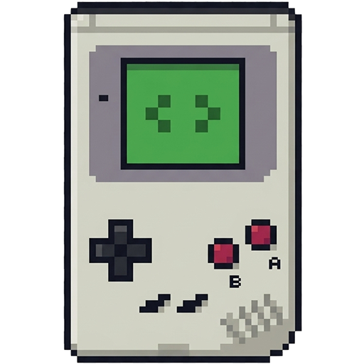
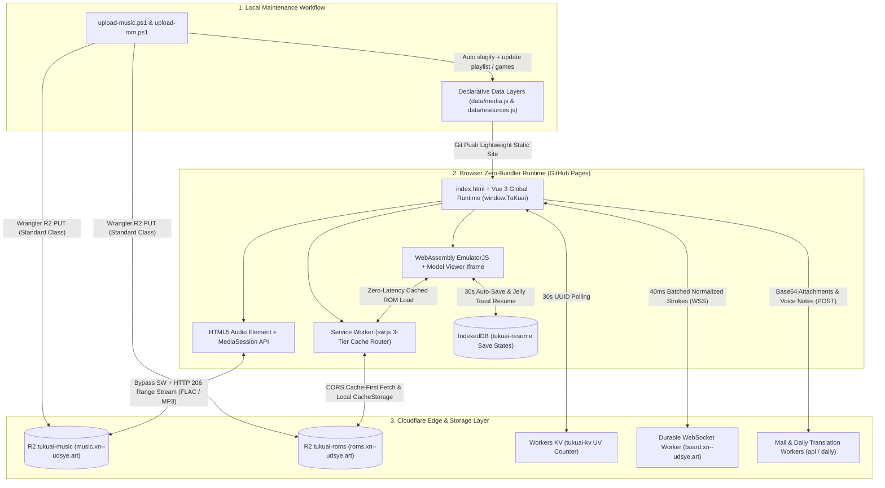

English | [简体中文](README.zh-CN.md)

# TuKuai OS

<p align="center">
  
</p>

<p align="center">
  <b>Interactive Cyberpunk & Pixel-Art Web Operating System</b> · <a href="https://xn--udsye.art">xn--udsye.art (土块.art)</a>
</p>

A zero-bundler, modular personal Web OS built for **TuKuai (GallantTarry)** combining Apple-style glassmorphism, CRT pixel aesthetics, lossless cloud audio streaming, WebAssembly handheld emulation, 3D scene rendering, and real-time multi-user collaboration. All daily content updates—uploading lossless music, uploading handheld ROMs, adding website URLs, or publishing apps—are handled via declarative data files and one-click R2 scripts without touching HTML or running a JS bundler.

---

## Quick Maintenance Guide

### 1. Uploading or Upgrading Music (`upload-music.ps1` -> Cloudflare R2)

All tracks use lowercase English `kebab-case` filenames (`.flac` lossless or `.mp3`), hosted in Cloudflare R2 bucket `tukuai-music` (`https://music.xn--udsye.art`) and archived locally in `Desktop/tukuai-music`.

- **GUI Picker (Fastest)**: Right-click [`upload-music.ps1`](./upload-music.ps1) -> **Run with PowerShell** (or run `.\upload-music.ps1` with no arguments), then select one or more `.flac` / `.mp3` files. The script automatically normalizes filenames to English `kebab-case`, archives a local copy, uploads to R2 (`Standard`), and updates `TK.data.playlist` in [`assets/js/app/data/media.js`](./assets/js/app/data/media.js) (upgrading `.mp3` -> `.flac` in-place and deleting the superseded `.mp3` on R2 when replacing an existing track).
- **CLI Upload / Full Sync**:
  ```powershell
  # Upload a single track or upgrade an existing track with an explicit display title
  .\upload-music.ps1 -Files "D:\Downloads\wind-poem.flac" -Title "Wind Poem"

  # Batch-sync all .flac / .mp3 files in Desktop\tukuai-music to R2
  .\upload-music.ps1 -SyncArchive
  ```

---

### 2. Adding Website URLs, Handheld ROMs, Apps & 3D Scenes

All 4 resource tabs are driven purely by [`assets/js/app/data/resources.js`](./assets/js/app/data/resources.js)—no edits to `index.html` are needed:

1. **Add an External Website URL (`Online Tools` tab)**:
   Append an object to `TK.data.onlineTools` in [`assets/js/app/data/resources.js`](./assets/js/app/data/resources.js):
   ```javascript
   {name: 'GitHub', desc: 'Social coding platform', url: 'https://github.com/'},
   ```
2. **Upload a Handheld ROM or Add a Web Game (`Retro Games` tab)**:
   ROMs (`.gba` / `.sfc` / `.smc` / `.nds` / `.nes` / `.gb` / `.gbc`) are hosted in Cloudflare R2 bucket `tukuai-roms` (`https://roms.xn--udsye.art`) and archived locally in `Desktop/tukuai-roms`, supporting large `.nds` titles beyond GitHub's 100 MB limit:
   ```powershell
   # Right-click upload-rom.ps1 -> Run with PowerShell, OR run via CLI:
   .\upload-rom.ps1 -Files "D:\ROMs\metal_slug.gba" -Title "Metal Slug Advance" -Emoji "🔫"
   ```
   `upload-rom.ps1` uploads the ROM to R2 and automatically appends `rom('🔫', 'Metal Slug Advance', 'metal_slug.gba')` to `TK.data.games`. To embed an external web game instead, add `{emoji: '🕹️', title: 'Web Game', desc: 'Brief intro', url: 'https://example.com/'}` to `TK.data.games`.
3. **Add a Self-Developed App (`Downloads` tab)**:
   Place the icon at `assets/images/apps/<slug>.ico`, landing page at `projects/<slug>/index.html`, intro video at `projects/<slug>/video/intro.mp4`, and manual at `projects/<slug>/docs/manual.md`, then add one line to `TK.data.projects`:
   ```javascript
   project('my-app', 'MyApp', 'One-line app description'),
   ```
4. **Add a 3D Model or Interactive Web Scene (`Creative Space` tab)**:
   Place `scene.gltf`, `scene.bin`, `textures/`, and `index.html` (copied from `models/residential-block/index.html`) into `models/<slug>/`, then append to `TK.data.creativeWorks`:
   ```javascript
   {emoji: '🌆', title: 'Cyber City Scan', desc: 'By TuKuai', url: './models/cyber-city/index.html'},
   ```
5. **Change Global API Endpoints or CDN Origins**:
   Edit `TK.config.api`, `TK.config.links`, `TK.config.audioBaseUrl`, or `TK.config.romBaseUrl` in [`assets/js/app/config.js`](./assets/js/app/config.js). Bump `CACHE_VERSION` in [`sw.js`](./sw.js) whenever overwriting cached static assets under an identical filename.

---

## Core Features Brief

- **PowerShell Boot & Dynamic Persona**: Matrix-style terminal decoding boot animation (`irm xn--udsye.art|iex`), real-time digital clock, 24-hour status-driven pixel avatars, and randomized quote bubbles.
- **Cloud Lossless Music Terminal**: 52-track curated soundtrack & classical library streamed via HTTP `206` Range from Cloudflare R2 (`music.xn--udsye.art`), featuring dynamic `FLAC_CODE` / `MP3_CODE` badges, a CRT mini-TV with 12 pixel MV GIFs, and full `navigator.mediaSession` integration (iOS Dynamic Island, lock screen, hardware media keys).
- **Real-Time Collaborative Board**: Multi-user WebSocket graffiti canvas (`0~1` normalized coordinates, `2.5x` Retina DPR scaling, and 40ms stroke batching).
- **Dual Full-Screen Portal Transitions**: 5-Phile petal fusion (live DOM coordinate flight + 1080-degree spin + Web Audio synthesized 5-note chord) and CRT overload implode jump.
- **Cloud-Backed WebAssembly Arcade & 3D Gallery**: 29 GBA/SFC classics streamed from R2 (`roms.xn--udsye.art`) and cached locally via Service Worker, featuring 30-second IndexedDB auto-saves (`tukuai-resume`) with spring-jelly resume prompts; plus 5 software showcases with `.mp4` video intros and 4 `<model-viewer>` 3D scenes.
- **Pigeon Mail & Bilingual Tech Reader**: Message modal supporting file attachments and `MediaRecorder` voice notes, plus `daily.html` bilingual GitHub Blog reader.

---

## Architecture & Data Flow



---

## End-to-End Flow & Core Technologies

| Stage | Data Flow | Core Technologies | What It Does |
| :--- | :--- | :--- | :--- |
| **1. Zero-Bundler Boot** | GitHub Pages -> `sw.js` -> `window.TuKuai` | Vue 3 Global Build, Tailwind CSS v3.4, 3-Tier `CacheStorage` | Loads `config.js` -> `utils` -> `data` -> `components` -> `composables` -> `main.js` sequentially with zero JS build step; routes HTML via Network-First, ROMs/3D models via Cache-First, and UI assets via Stale-While-Revalidate |
| **2. Cloud Audio Streaming** | `upload-music.ps1` -> R2 `tukuai-music` -> `<audio>` | Cloudflare R2 (`Standard`), CORS `Range`, HTTP `206 Partial Content`, `MediaMetadata` | Streams English `kebab-case` `.flac`/`.mp3` from `music.xn--udsye.art`, bypassing Service Worker cache for instant byte-range seeking and syncing metadata to iOS Dynamic Island |
| **3. Cloud ROM Arcade & Saves** | `upload-rom.ps1` -> R2 `tukuai-roms` -> `sw.js` -> `emulator.html` | EmulatorJS WASM, CORS `CacheStorage`, `IndexedDB` (`tukuai-resume`) | Fetches ROMs from `roms.xn--udsye.art` on first launch and caches permanently in `CacheStorage` for 0ms repeat loads; keys battery/instant saves strictly on `?rom=<filename>` and snapshots state every 30s & before window close |
| **4. Collaborative & Edge APIs** | Browser UI <-> Cloudflare Workers | WebSocket (`wss://`), Workers KV, HTML5 Canvas DPR `2.5x`, `MediaRecorder` | Broadcasts `0.0000~1.0000` normalized strokes in 40ms batches (up to 5,000 history items), tracks deduplicated device UUID visitor counts, and dispatches voice/attachment Pigeon Mail |

---

## Directory Structure

```text
tukuai-os/
├── index.html                          # Main SPA shell (Vue 3 runtime template)
├── daily.html                          # Bilingual GitHub Blog reader terminal
├── sw.js                               # 3-tier PWA Service Worker cache router
├── upload-music.ps1                    # One-click R2 music uploader & media.js updater
├── upload-rom.ps1                      # One-click R2 handheld ROM uploader & resources.js updater
├── hello.ps1                           # Audio-synced PowerShell terminal monologue easter egg
├── CNAME                               # Custom domain binding (xn--udsye.art)
├── README.md                           # Primary English documentation
├── README.zh-CN.md                     # Synchronized Simplified Chinese documentation
├── assets/
│   ├── css/                            # Tailwind input/output CSS & custom glass/CRT animations
│   ├── fonts/                          # Local Silkscreen & Zpix pixel fonts
│   ├── images/                         # Favicons, 8 status SVG avatars, wallpapers, 12 TV GIFs, app icons
│   └── js/
│       ├── vendor/                     # Self-hosted vue.global.js & model-viewer.min.js
│       └── app/
│           ├── config.js               # Global window.TuKuai namespace, API URLs & R2 CDN origins
│           ├── utils/helpers.js        # Pure utility functions (formatting, random, audio fade)
│           ├── data/                   # Declarative content layer (menu, resources, media, content)
│           ├── components/             # Reusable Vue components (cards, mail modal, engine help)
│           ├── composables/            # 13 modular feature hooks (music, board, window, transitions)
│           ├── core/                   # Zoom lock, Web Worker title marquee & SW registration
│           └── main.js                 # Root Vue app assembly & bfcache recovery
├── games/                              # EmulatorJS WASM cores & R2-backed IndexedDB save host (emulator.html)
├── models/                             # 4 interactive <model-viewer> 3D GLTF scenes
└── projects/                           # 5 standalone software showcases with intro videos & manuals
```

---

## Copyright & Notice

```text
Copyright (c) 2026 TuKuai (GallantTarry). All rights reserved.
```

Source code is publicly visible on GitHub for **browsing, learning, and technical reference only** (**All Rights Reserved**; see [`LICENSE`](./LICENSE)). Third-party libraries (`vue.global.js`, `model-viewer.min.js`), pixel fonts (`assets/fonts/OFL.txt`), EmulatorJS cores (`GPL-3.0`), and 3D scans (`models/*/license.txt`, `CC-BY-4.0`) remain under their respective original licenses.
