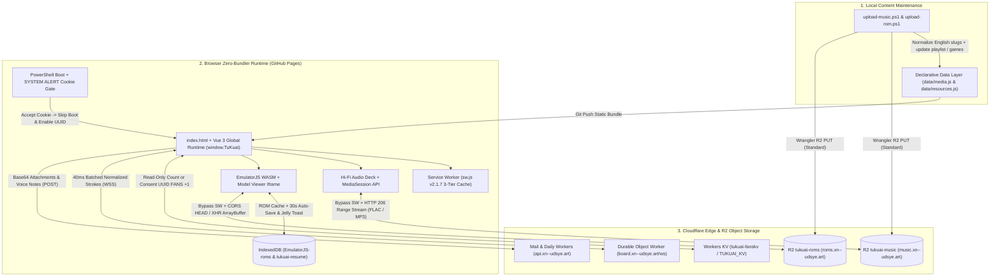

English | [简体中文](README.zh-CN.md)

# TuKuai OS

<p align="center">
  
</p>

<p align="center">
  <b>Interactive Cyberpunk & Pixel-Art Web Operating System</b> · <a href="https://xn--udsye.art">xn--udsye.art (土块.art)</a>
</p>

A zero-bundler, modular personal Web OS built for **TuKuai (GallantTarry)** blending translucent crystal glassmorphism, CRT pixel aesthetics, Cloudflare R2 lossless audio streaming, R2-backed WebAssembly handheld emulation, 3D scene showcases, and real-time multi-user graffiti. Routine content updates—uploading lossless music, uploading handheld ROMs, adding website URLs, swapping 2K AVIF wallpapers, or publishing apps—are managed via declarative data files and one-click PowerShell scripts without modifying `index.html` or running a JavaScript bundler.

---

## Quick Maintenance Guide

### 1. Uploading or Upgrading Music (`upload-music.ps1` -> Cloudflare R2)

All audio tracks use lowercase English `kebab-case` filenames (`.flac` lossless or `.mp3`), hosted in Cloudflare R2 bucket `tukuai-music` (`https://music.xn--udsye.art`) and archived locally in `Desktop/tukuai-music`.

- **GUI Picker (Fastest)**: Right-click [`upload-music.ps1`](./upload-music.ps1) -> **Run with PowerShell** (or run `.\upload-music.ps1` with no arguments), then select `.flac` / `.mp3` files. The script normalizes filenames to English `kebab-case`, archives a local copy, uploads to R2 (`Standard`), and updates `TK.data.playlist` in [`assets/js/app/data/media.js`](./assets/js/app/data/media.js) (automatically upgrading `.mp3` -> `.flac` in-place and cleaning up superseded R2 `.mp3` keys).
- **CLI Upload / Archive Sync**:
  ```powershell
  # Upload a track (or upgrade an existing slug) with a custom display title
  .\upload-music.ps1 -Files "D:\Downloads\wind-poem.flac" -Title "Wind Poem"

  # Sync all .flac / .mp3 files in Desktop\tukuai-music to R2
  .\upload-music.ps1 -SyncArchive
  ```

---

### 2. Adding Website URLs, Handheld ROMs, Wallpapers, Apps & 3D Scenes

Resource cards and media pools are driven purely by [`assets/js/app/data/resources.js`](./assets/js/app/data/resources.js) and [`assets/js/app/data/media.js`](./assets/js/app/data/media.js):

1. **Add an External Website URL (`Online Tools` tab)**:
   Append an item to `TK.data.onlineTools` in [`assets/js/app/data/resources.js`](./assets/js/app/data/resources.js):
   ```javascript
   {name: 'GitHub', desc: 'Social coding platform', url: 'https://github.com/'},
   ```
2. **Upload a Handheld ROM or Add a Web Game (`Retro Games` tab)**:
   Handheld ROMs (`.gba` / `.sfc` / `.smc` / `.nds` / `.nes` / `.gb` / `.gbc`) are hosted in Cloudflare R2 bucket `tukuai-roms` (`https://roms.xn--udsye.art`, open read-only CORS):
   ```powershell
   # Right-click upload-rom.ps1 -> Run with PowerShell, OR run via CLI:
   .\upload-rom.ps1 -Files "D:\ROMs\metal_slug.gba" -Title "Metal Slug Advance" -Emoji "🔫"
   ```
   `upload-rom.ps1` uploads the ROM to R2 and appends `rom('🔫', 'Metal Slug Advance', 'metal_slug.gba')` to `TK.data.games`. For external web games, append `{emoji: '🕹️', title: 'Web Game', desc: 'Short intro', url: 'https://example.com/'}` directly.
3. **Add or Replace Random Wallpapers (`2K AVIF`)**:
   Place 2K (`~2048px` long edge) `.avif` wallpapers inside `assets/images/backgrounds/` and register the path in `TK.data.backgrounds` in [`assets/js/app/data/media.js`](./assets/js/app/data/media.js).
4. **Add a Self-Developed App (`Downloads` tab)**:
   Place the icon at `assets/images/apps/<slug>.ico`, page at `projects/<slug>/index.html`, intro video at `projects/<slug>/video/intro.mp4`, and manual at `projects/<slug>/docs/manual.md`, then append to `TK.data.projects`:
   ```javascript
   project('my-app', 'MyApp', 'One-line app description'),
   ```
5. **Add a 3D Model or Interactive Web Scene (`Creative Space` tab)**:
   Place `scene.gltf`, `scene.bin`, `textures/`, and `index.html` (copied from `models/residential-block/index.html`) into `models/<slug>/`, then append to `TK.data.creativeWorks`:
   ```javascript
   {emoji: '🌆', title: 'Cyber City Scan', desc: 'By TuKuai', url: './models/cyber-city/index.html'},
   ```
6. **Change Global API Endpoints or Cache Version**:
   Edit `TK.config.api`, `TK.config.links`, `TK.config.audioBaseUrl`, or `TK.config.romBaseUrl` in [`assets/js/app/config.js`](./assets/js/app/config.js). Increment `CACHE_VERSION` in [`sw.js`](./sw.js) whenever replacing cached static files in-place.

---

## Core Features Brief

- **Consent-Gated PowerShell Boot & `FANS` Counter**: Responsive PowerShell matrix boot animation (`irm xn--udsye.art|iex`) paired with a panel-sized `SYSTEM ALERT` Cookie consent gate over the profile card. Accepting stores local Cookies (`tukuai_cookie_consent`, `tukuai_device_uuid`), triggers deduplicated `FANS +1`, and skips the boot animation on return visits; declining writes zero local data, leaves `FANS` unchanged, and replays the boot sequence next time.
- **Crystal-Glass Hi-Fi Music Deck**: 52-track library streamed via HTTP `206` Range from Cloudflare R2 (`music.xn--udsye.art`), featuring an obsidian mini-CRT MV screen, `FLAC` / `MP3` lossless badges, live 4-bar pixel equalizer, neon-filled scrubbers, and OS-level `navigator.mediaSession` controls (iOS Dynamic Island, lock screen, media keys).
- **Real-Time Collaborative Board**: Multi-user WebSocket graffiti canvas (`0~1` normalized coordinates, `2.5x` Retina DPR scaling, and 40ms stroke batching).
- **Dual Full-Screen Portal Transitions**: 5-Phile petal fusion (live DOM coordinate flight + 1080-degree spin + Web Audio 5-note chord) and CRT overload implode jump.
- **Cloud-Backed WebAssembly Arcade & 3D Gallery**: 29 GBA/SFC classics fetched from R2 (`roms.xn--udsye.art`) and cached by EmulatorJS `IndexedDB` (`EmulatorJS-roms`), paired with 30-second auto-save snapshots (`tukuai-resume`) and spring-jelly resume toasts; plus 5 software showcases with `.mp4` intros and 4 `<model-viewer>` 3D scenes.
- **Pigeon Mail & Bilingual Tech Reader**: Attachment + `MediaRecorder` voice-note mail modal and `daily.html` bilingual GitHub Blog reader.

---

## Architecture & Data Flow



---

## End-to-End Flow & Core Technologies

| Stage | Data Flow | Core Technologies | What It Does |
| :--- | :--- | :--- | :--- |
| **1. Zero-Bundler Boot & Consent Gate** | GitHub Pages -> `sw.js` -> `useCookieConsent` -> `window.TuKuai` | Vue 3 Global Build, Browser `Cookie` (`SameSite=Lax`, 1y TTL), `CacheStorage` | Loads modular scripts sequentially with zero JS bundler; caches 2K `.avif` wallpapers, fonts, WASM cores, and 3D models via Cache-First; gates boot-skip and `FANS +1` strictly on explicit user Cookie consent |
| **2. Cloud Lossless Audio Deck** | `upload-music.ps1` -> R2 `tukuai-music` -> `<audio>` | Cloudflare R2 (`Standard`), CORS `Range`, HTTP `206 Partial Content`, `MediaMetadata` | Streams English `kebab-case` `.flac`/`.mp3` directly from `music.xn--udsye.art` (bypassing SW for zero-latency seeking) and syncs playback state to iOS Dynamic Island & hardware keys |
| **3. Cloud ROM Arcade & Auto-Save** | `upload-rom.ps1` -> R2 `tukuai-roms` -> `emulator.html` -> `IndexedDB` | EmulatorJS v4.2.3 WASM, CORS `HEAD`/`GET`, `IndexedDB` (`EmulatorJS-roms` & `tukuai-resume`) | Downloads ROMs directly from `roms.xn--udsye.art` on first run and caches up to 1 GB in `EmulatorJS-roms` via `Content-Length` verification; snapshots save states every 30s & on close with spring-jelly resume toast |
| **4. Real-Time Board & Edge APIs** | Browser UI <-> Cloudflare Workers | WebSocket (`wss://`), Durable Objects, Workers KV (`TUKUAI_KV`), `MediaRecorder` | Syncs `0.0000~1.0000` normalized strokes in 40ms batches (up to 5,000 lines at `2.5x` DPR), serves read-only or UUID-deduplicated `fans` counts, and delivers voice/attachment Pigeon Mail |

---

## Directory Structure

```text
tukuai-os/
├── index.html                          # Main SPA shell (Vue 3 runtime template & crystal-glass UI)
├── daily.html                          # Bilingual GitHub Blog reader terminal
├── sw.js                               # 3-tier PWA Service Worker cache router (bypasses R2 media origins)
├── upload-music.ps1                    # One-click R2 music uploader & media.js playlist updater
├── upload-rom.ps1                      # One-click R2 handheld ROM uploader & resources.js game updater
├── hello.ps1                           # Audio-synced PowerShell terminal monologue easter egg
├── CNAME                               # Custom domain binding (xn--udsye.art)
├── README.md                           # Primary English documentation
├── README.zh-CN.md                     # Synchronized Simplified Chinese documentation
├── assets/
│   ├── css/                            # Precompiled Tailwind output.css & custom crystal-glass/Hi-Fi style.css
│   ├── fonts/                          # Local Silkscreen & Zpix Chinese pixel fonts
│   ├── images/                         # Favicons, 8 status SVG avatars, 6 2K AVIF wallpapers, 12 TV GIFs, app icons
│   └── js/
│       ├── vendor/                     # Self-hosted vue.global.js & model-viewer.min.js
│       └── app/
│           ├── config.js               # Global window.TuKuai namespace, API URLs, R2 origins & Cookie config
│           ├── utils/helpers.js        # Stateless utilities (time, colors, audio fade, Cookie & UUID helpers)
│           ├── data/                   # Declarative data layer (menu, resources, R2 playlist & AVIFs, content)
│           ├── components/             # Reusable Vue components (tab-section, cards, mail modal, engine help)
│           ├── composables/            # 13 feature modules (cookie consent, boot, UV, Hi-Fi music, board, etc.)
│           ├── core/                   # Mobile zoom lock, Web Worker title marquee & SW hot-reload
│           └── main.js                 # Root Vue app assembly & bfcache state restoration
├── games/                              # EmulatorJS WASM cores & R2-backed IndexedDB save host (emulator.html)
├── models/                             # 4 interactive <model-viewer> 3D GLTF scenes
└── projects/                           # 5 standalone software showcases with intro videos & manuals
```

---

## Copyright & Notice

```text
Copyright (c) 2026 TuKuai (GallantTarry). All rights reserved.
```

Source code is publicly visible on GitHub for **browsing, learning, and technical reference only** (**All Rights Reserved**; see [`LICENSE`](./LICENSE)). Third-party libraries (`vue.global.js`, `model-viewer.min.js`), pixel fonts (`assets/fonts/OFL.txt`), EmulatorJS / RetroArch / mGBA / Snes9x cores (`GPL-3.0`), and 3D scans (`models/*/license.txt`, `CC-BY-4.0`) remain under their respective original licenses.
