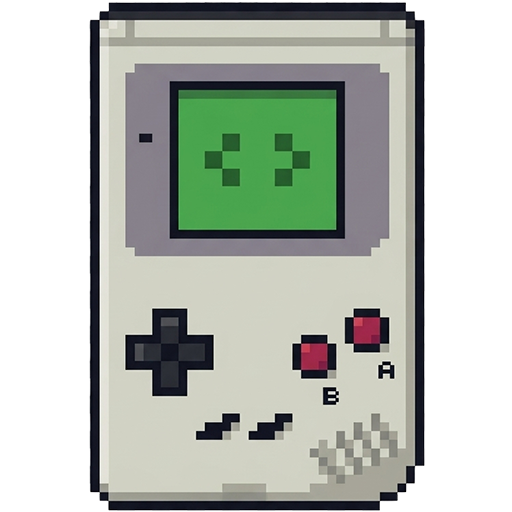
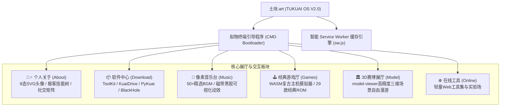

# 🌐 土块的主站 (TuKuai OS / 少侠别走)

<p align="center">
  
</p>

<p align="center">
  <b>沉浸式复古赛博朋克风格个人官方主站与交互式 Web 操作系统</b><br>
  <i>TUKUAI OS CORE DISK V2.0.0 // APPLE_GLASS_BUILD</i>
</p>

<p align="center">
  <a href="https://xn--udsye.art" target="_blank"></a>
  
  
  
  
  
  
</p>

---

## 📖 项目全貌 (Overview)

本项目是 **土块 (GallantTarry)** 的个人官方门户站与综合创意交互中心（访问域名：[土块.art](https://xn--udsye.art)）。

站点整体以 **赛博朋克 (Cyberpunk) + 复古像素 (Pixel Art)** 为核心视觉基调，脱离了常规扁平化个人主页的单一模式，构建了一个高度交互、自成一体的 **Web OS 虚拟操作系统（TUKUAI OS）**。

全站基于 **Vue 3 渐进式开发**，集成 **Tailwind CSS 3.4** 现代原子化样式，拥有终端 CMD 拟物启动器、自研桌面软件全景展示、50+ 精选原声像素音乐台、内置 29 款殿堂级经典主机游戏的 WebAssembly 模拟器、以及 Google `<model-viewer>` 驱动的 3D 沉浸式赛博模型展厅。

---

## 🌟 核心特色与功能模块 (Core Features)



### 1. 💻 终端拟物引导程序 (CMD Bootloader)
* 访问主站时，以沉浸式的 Windows 控制台拟物视窗呈现，伴随打字机效果逐行加载系统核心模块状态。
* 搭载 CRT 荧光扫描线效果、微粒背景流光粒子系统，以及跃迁过载坍缩动画。

### 2. 🙋‍♂️ 个人画像与状态看板 (About)
* **动态多态头像**：提供 8 种生活与编码姿态无缝切换（`coding` 敲代码、`gaming` 游戏、`listening` 听歌、`slacking_off` 摸鱼、`sleeping` 睡眠、`smoking` 放松、`swimming` 游泳、`working` 办公）。
* **极客技术栈全景展示**：涵盖 Java 21、Python、Golang、Vue、Tailwind、Wails、Swing、Three.js、PWA 等多端跨平台研发能力。
* **极客箴言与社交矩阵**：内置 GitHub、微信、博客等友链通道。

### 3. 📦 独立自研桌面端软件矩阵 (Download Center)
站点集中发布并维护了 4 款不同领域的自研独立客户端，每款软件均配套专属展示单页与操作说明文档：

| 软件名称 | 技术栈与定位 | 核心能力描述 | 专属页面 |
| :--- | :--- | :--- | :---: |
| **ToolKit** | **Java 21 + Swing + FlatLaf**<br>现代化多功能协同办公工具箱 | <ul><li>9 大功能面板永驻内存，支持全量工作区跨重启持久化恢复。</li><li>招投标 AP/GP 报价规律合规性检测与围标串标预警。</li><li>Word/PDF 协同改名、银行回单要素解析提取、Word 转 PDF。</li><li>内置 DeepSeek AI 桌面小猫 Miti 与《拯救公猪》动作跑酷彩蛋。</li></ul> | [ToolKit.html](projects/ToolKit/ToolKit.html) |
| **KuaiDrive** | **Go + Wails + Vue + Tailscale**<br>安全极简异地局域网磁盘挂载 | <ul><li>基于 Tailscale 虚拟网卡技术，零公网 IP 实现点对点穿透直连。</li><li>无缝融合 Cloudflare Workers + KV 临时凭证与 IP 动态密文转换。</li><li>实现轻量异地局域网盘挂载与加密文件传输，免去中继服务器高昂带宽费。</li></ul> | [KuaiDrive.html](projects/KuaiDrive/KuaiDrive.html) |
| **PyKuai** | **Python 3 + 自动化工作台**<br>极客桌面批量自动化处理工具箱 | <ul><li>面向未安装 Python 环境的桌面用户的一键式脚本矩阵。</li><li>多表合并/拆分、矩阵解压、图片/视频智能压缩、扫描件化处理。</li><li>PDF 断点拆分、音视频嗅探提取、剪贴板自动化捕获。</li></ul> | [PyKuai.html](projects/PyKuai/PyKuai.html) |
| **BlackHole** | **极简悬浮球 + 鼠标手势交互**<br>桌面暗物质极简归档与整理神器 | <ul><li>纯鼠标手势操作（无边框、无传统按钮设计），支持圆形视界碰撞拖拽。</li><li>桌面混乱文件一键吞噬拖入自动归档、内存快速清理。</li><li>屏幕便利贴贴图自由缩放、暗物质待办清单管理与粉碎动画。</li></ul> | [BlackHole.html](projects/BlackHole/BlackHole.html) |

### 4. 🎵 复古像素音乐台 (Pixel Music Station)
* 收录了 **50+ 首精选高品质 BGM**，涵盖久石让经典、影视原声（《星际穿越》《飞越疯人院》）、古典交响乐（巴赫、贝多芬、圣桑）、独立游戏配乐（《我的世界》《超时空之轮》《旅行者》《去月球》）等。
* 搭载像素复古磁带/黑胶播放机交互控制台，支持播放模式切换、进度拖拽与可视化动效。

### 5. 🕹️ 经典复古游戏主机模拟器 (Classic Games Arena)
* 基于 **WebAssembly (EmulatorJS / RetroArch 内核)**，无插件即开即玩。
* 内置近 **30 款** 80/90 后童年殿堂级 ROM 游戏：
  * **GBA 经典**：塞尔达传说：缩小帽、塞尔达传说：四支剑、黄金太阳 1 & 2、火炎之纹章、逆转裁判 1/2/3、口袋妖怪：绿宝石、恶魔城：晓月圆舞曲、星之卡比、高级战争、光明之魂 2、瓦力欧制造等。
  * **SFC / SNES 传奇**：超时空之轮 (Chrono Trigger)、勇者斗恶龙 3 & 5、最终幻想 6、超级马力欧、超级银河战士、天地创造、沙罗曼蛇 3 等。
* 完整支持多档即时存档、按键映射、画质滤镜与全屏体验。

### 6. 🏛️ 3D 沉浸式赛博模型展厅 (3D Cyber Gallery)
* 依托 Google Web Components 库 `<model-viewer>`。
* 提供 4 款精美 3D 模型的沉浸式三维交互：
  * **圣波利卡普天主教堂**
  * **居民街区**
  * **梵高阿尔勒的卧室**
  * **欢乐时光号飞船**
* 支持鼠标/触摸 360 度视角旋转、镜头缩放、PBR 材质自适应与光影自动烘焙。

---

## ⚡ 性能与离线缓存策略 (PWA Service Worker)

为了解决大体积游戏 ROM、音频及 3D 模型带来的加载延迟，站点在 `sw.js` 中构建了智能双层缓存引擎：

* **策略 A：网页骨架 (HTML / JS / CSS)** ➔ **网络优先，缓存兜底 (Network-First)**：
  保证用户每次刷新均能接收到 GitHub Pages / Cloudflare 最新的更新，断网时自动启用离线兜底。
* **策略 B：重度静态资产 (ROM / WASM / MP3 / 3D GLTF / 字体)** ➔ **缓存优先 (Cache-First)**：
  大文件下载一次即可终身缓存在本地 CacheStorage，实现秒进畅玩，大幅降低服务器带宽消耗。
* **动态旁路过滤**：自动穿透拦截非 GET 请求、Google Analytics 埋点及 Cloudflare KV 统计接口，保证统计实时性。

---

## 📂 项目目录结构 (Directory Structure)

```text
TuKuai/
├── CNAME                       # 绑定自定义主域名 (土块.art -> xn--udsye.art)
├── index.html                  # 主站单页入口 (Vue 3 + Tailwind CSS + 各大展区)
├── package.json                # Node.js 工程依赖与构建指令
├── tailwind.config.js          # Tailwind CSS 自定义字体与扫描配置
├── sw.js                       # PWA Service Worker 核心智能缓存路由策略
├── README.md                   # 官方仓库说明文档
├── css/
│   ├── input.css               # Tailwind CSS 源码入口
│   ├── output.css              # Tailwind CLI 编译压缩后成品样式
│   └── style.css               # 自定义像素复古与赛博朋克特效样式
├── font/                       # 复古英文字体 (Silkscreen) 与中文像素字体 (Zpix)
├── js/
│   ├── vue.global.js           # Vue 3 运行时库
│   ├── tailwindcss.js          # Tailwind 辅助脚本
│   └── model-viewer.min.js     # Google 3D 模型渲染组件
├── svg/                        # 8 态动态矢量头像与交互图标
├── imgs/                       # 站点 Favicon、Logo、背景装饰图
├── music/                      # 50+ 精选原声与古典音乐音频库 (.mp3)
├── models/                     # 3D 高精度模型资产目录
├── game/                       # 经典主机 WebAssembly 模拟器模块
│   ├── emulator.html           # 模拟器承载页
│   ├── emulator_data/          # 模拟器 BIOS 与 WASM 编译内核
│   └── rom/                    # GBA / SFC 经典游戏 ROM 仓库
└── projects/                   # 4 大自研独立桌面软件展厅与说明书
    ├── ToolKit/                # ToolKit 专属展示单页、图片、音乐与说明文档
    ├── KuaiDrive/              # KuaiDrive 专属展示单页与说明文档
    ├── PyKuai/                 # PyKuai 极客工作台专属单页与说明文档
    └── BlackHole/              # BlackHole 黑洞专属单页、GIF 演示与说明文档
```

---

## 🛠️ 本地开发与构建 (Getting Started)

### 环境依赖
* **Node.js**：v16.0.0 或更高版本
* **包管理器**：npm / yarn / pnpm

### 1. 克隆代码仓库
```bash
git clone https://github.com/GallantTarry/TuKuai.git
cd TuKuai
```

### 2. 安装依赖
```bash
npm install
```

### 3. 本地样式监听与编译 (Tailwind CSS)
```bash
# 开发环境：实时监听 input.css 并重新输出
npm run dev

# 生产环境：极速压缩编译
npm run build
```

### 4. 预览运行
无需复杂的本地后端服务，可使用任意静态本地服务器（如 VS Code Live Server 或 `npx serve`）直接启动：
```bash
npx serve .
```
在浏览器中打开对应端口（例如 `http://localhost:3000`）即可完整体验。

---

## 🌐 线上访问与联系作者 (Links)

* 🌍 **官方网站**：[土块.art](https://xn--udsye.art)
* 🐙 **GitHub 主页**：[@GallantTarry](https://github.com/GallantTarry)
* 💡 **关于作者**：土块 (GallantTarry) —— 热衷于极致交互、办公自动化与全栈桌面应用开发的独立开发者。

---

## 📄 开源许可证 (License)

本项目采用 [MIT License](LICENSE) 授权开源。

```text
Copyright (c) 2026 TuKuai (GallantTarry)
```

