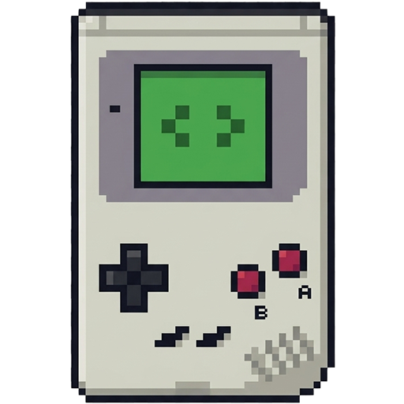
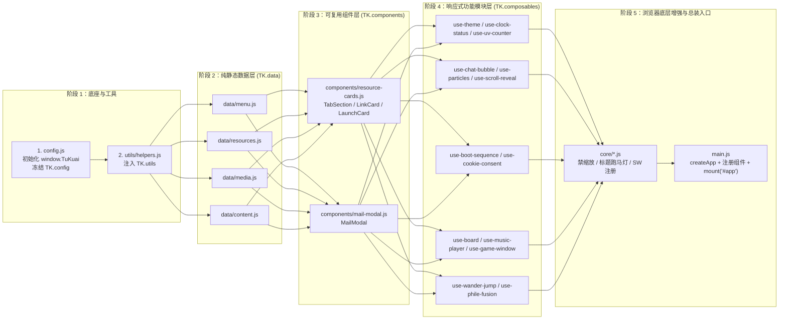
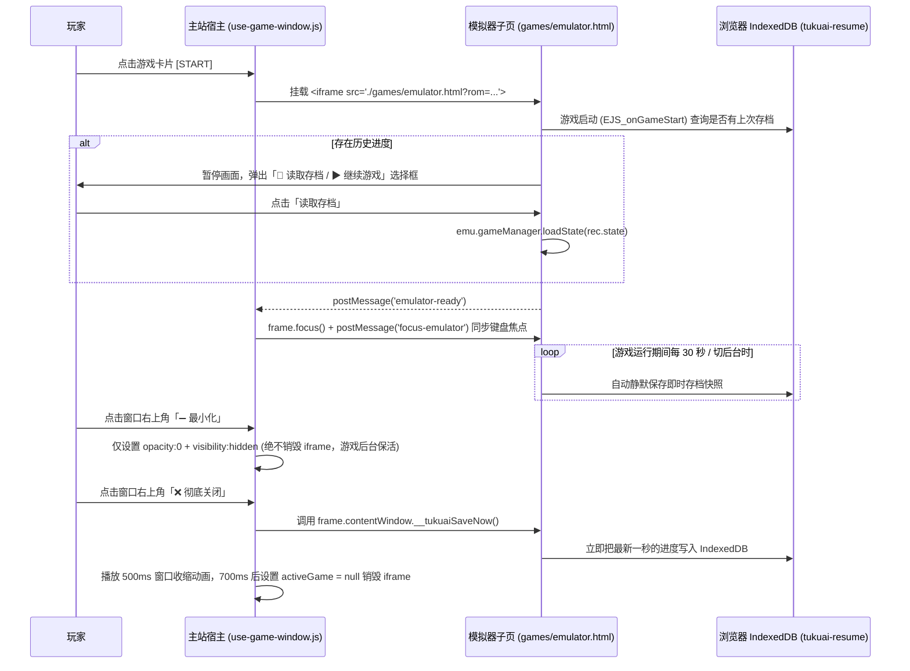

# 🌐 少侠别走 · 土块.art (TuKuai OS V2.0)

<p align="center">
  
</p>

<p align="center">
  <b>沉浸式复古赛博朋克风格个人官方主站 · 交互式 Web 虚拟操作系统</b><br>
  <i>TUKUAI OS CORE DISK V2.0.0 // APPLE_GLASS_BUILD</i>
</p>

<p align="center">
  <a href="https://xn--udsye.art" target="_blank"></a>
  
  
  
  
  
  
</p>

---

## 📑 目录 (Table of Contents)

1. [项目全貌与核心特性](#-一项目全貌与核心特性-overview)
2. [标准工程目录树](#-二标准工程目录树-directory-structure)
3. [技术栈与架构设计详解](#-三技术栈与架构设计详解-architecture--design)
   - [3.1 零打包器（Zero-Bundler）模块化架构](#31-零打包器zero-bundler模块化架构)
   - [3.2 全局命名空间 `window.TuKuai` 与脚本加载链路](#32-全局命名空间-windowtukuai-与脚本加载链路)
   - [3.3 全部 25 个核心前端模块职责与调用关系表](#33-全部-25-个核心前端模块职责与调用关系表)
   - [3.4 关键底层技术机制剖析](#34-关键底层技术机制剖析)
   - [3.5 云端后端服务与外部接口调用清单](#35-云端后端服务与外部接口调用清单)
4. [后期内容新增与维护指南（保姆级实操手册）](#-四后期内容新增与维护指南-maintenance--extension-guide)
   - [4.1 新增/修改「在线使用」外链工具](#41-新增修改在线使用外链工具)
   - [4.2 新增/修改「文件下载（资源库）」自研软件](#42-新增修改文件下载资源库自研软件)
   - [4.3 新增/修改「复古游戏」掌机 ROM 或网页游戏](#43-新增修改复古游戏掌机-rom-或网页游戏)
   - [4.4 新增/修改「创意空间」3D 模型或互动网页](#44-新增修改创意空间3d-模型或互动网页)
   - [4.5 新增/修改「电子音乐」歌曲、小电视动图与背景壁纸](#45-新增修改电子音乐歌曲小电视动图与背景壁纸)
   - [4.6 修改导航菜单、霓虹主题色、作息表与状态语录](#46-修改导航菜单霓虹主题色作息表与状态语录)
   - [4.7 修改后端接口地址、跃迁网址与刷新全站缓存](#47-修改后端接口地址跃迁网址与刷新全站缓存)
5. [本地开发、样式编译与部署流程](#-五本地开发样式编译与部署流程-development--deployment)

---

## 🌟 一、项目全貌与核心特性 (Overview)

本项目是 **土块 (GallantTarry)** 的个人官方门户站与综合创意交互中心（主域名：[土块.art](https://xn--udsye.art) / `https://xn--udsye.art`）。

站点以 **赛博朋克毛玻璃 (Apple Glass + Cyberpunk) + 复古像素 (Pixel Art)** 为核心视觉语言，构建了一套自成一体的交互式 **Web 虚拟操作系统（TuKuai OS V2.0）**：

* **💻 PowerShell 拟物开机引导 (`use-boot-sequence.js`)**：首次访问时呈现复古终端窗口，伴随矩阵乱码逐字解码出启动指令 `irm xn--udsye.art|iex`，随后平滑切入桌面。
* **🎨 全服实时协同「土块画板」(`use-board.js`)**：在「我的简介」点击右上角「公告」即可果冻翻转进入全服涂鸦画板。基于 WebSocket 实时广播笔触，采用 `0~1` 归一化比例坐标与 `2.5x` Retina 高清像素比适配，手机与 4K 大屏画面分毫不差。
* **🌸 双重全屏跃迁特效 (`use-phile-fusion.js` / `use-wander-jump.js`)**：
  * 点击简介页 5 个彩色性格胶囊，触发 **5-Phile 花瓣聚变旋转跃迁**（实时测量按钮 DOM 坐标起飞 → 中心合拢 → 1080° 高速旋转 → 绽放高清花朵 + Web Audio API 实时合成五音上行和弦）；
  * 点击底部名言触发 **Wander Jump 漫游者坍缩跃迁**（界面过载抖动 → 老式 CRT 电视关机坍缩 + 背景音乐断电式渐弱）。
* **✉️ 飞鸽传书多媒体密函系统 (`mail-modal.js`)**：点击左上角像素小人头像弹出密函窗口，支持文字留言、Emoji 选择、多文件附件上传、**浏览器原生麦克风语音录制与即时试听**（自动兼容 iOS `.m4a` 与桌面 `.webm`）、以及赛博荧光绿滤镜渲染的微信打赏码全息层。
* **🎵 电子音乐终端与系统灵动岛接管 (`use-music-player.js`)**：内置 50+ 首精选原声与古典曲目，配备带 CRT 扫描线的复古迷你电视机（随机切换 12 款像素 MV 动图），并通过 `navigator.mediaSession` 完整接管 iOS 灵动岛、锁屏界面、Android 通知栏与键盘多媒体键。
* **🕹️ WebAssembly 复古掌机游戏厅 (`games/emulator.html`)**：内置 29 款 GBA / SFC 殿堂级经典游戏，无插件即点即玩；自研基于 **IndexedDB 的自动进度保存与恢复系统**（每 30 秒、切后台、或关闭窗口前自动保存即时存档，下次进入弹窗询问读取进度）。
* **📦 5 大自研软件与游戏独立展厅 (`projects/`)**：集中展示 `BlackHole`、`ToolKit`、`PyKuai`、`KuaiDrive`、`Clod＆Gold` 五款自研作品，支持点击 `OPEN` 先全屏播放专属片头 `.mp4` 动画（底层 `<iframe>` 并行预加载），再无缝切入产品交互主页与在线说明书。
* **🧊 3D 沉浸式赛博模型展厅 (`models/`)**：基于 Google `<model-viewer>` 渲染 4 座高精度 3D 实景扫描与艺术场景，支持 360° 环绕交互。
* **📰 极客技术视界双语精读终端 (`daily.html`)**：点击右上角 GitHub 时钟唤醒，自动拉取 GitHub Blog 最新技术长文并调用云端代理生成**中英双语段落对照精读视图**。

---

## 📂 二、标准工程目录树 (Directory Structure)

整个仓库遵循现代前端工程化规范：根目录仅保留入口页面与工程配置文件；所有样式、脚本、字体、音频、图片统一收拢至 `assets/`；所有子系统（`games/`、`models/`、`projects/`）及资源文件均采用纯英文小写 `kebab-case` 命名，子模块入口统一规范为 `index.html`。

```text
TuKuai/
├── .gitignore                          # Git 忽略规则配置 (忽略 node_modules/、.idea/、.vscode/ 等)
├── CNAME                               # GitHub Pages 自定义域名绑定 (xn--udsye.art)
├── favicon.ico                         # 网站根目录兜底图标 (16/32/48px，供搜索引擎爬虫与旧浏览器抓取)
├── robots.txt                          # 搜索引擎爬虫抓取规则 (允许全站收录并指向 sitemap.xml)
├── sitemap.xml                         # 站点地图 (辅助 Google / Bing 快速索引主站与作品展厅)
├── site.webmanifest                    # PWA Web 应用清单 (配置桌面快捷方式名称与 192/512px 图标)
├── README.md                           # 项目技术架构、调用关系与后期扩展维护文档
├── package.json                        # NPM 构建脚本与 Tailwind CSS 依赖配置
├── package-lock.json                   # NPM 依赖版本锁定文件
├── tailwind.config.js                  # Tailwind CSS 扫描范围与自定义像素字体配置
├── sw.js                               # PWA Service Worker 智能三级缓存引擎 (必须位于根目录以覆盖全站作用域)
├── index.html                          # 主站单页应用 HTML 骨架入口 (TuKuai OS)
├── daily.html                          # 极客技术视界 (GitHub Blog 中英双语精读终端，由顶栏时钟唤醒)
├── hello.ps1                           # 终端音频同步独白彩蛋脚本 (支持 irm https://xn--udsye.art/hello.ps1 | iex)
│
├── assets/                             # 【核心静态资源与前端源码总目录】
│   ├── css/                            # 样式表目录
│   │   ├── input.css                   # Tailwind CSS 源码指令入口 (@tailwind base/components/utilities)
│   │   ├── output.css                  # Tailwind CLI 编译压缩产物 (执行 npm run build 生成)
│   │   └── style.css                   # 手写核心样式：毛玻璃、CRT 扫描线、土块画板、5-Phile 聚变与坍缩动画
│   │
│   ├── fonts/                          # 本地像素字体库
│   │   ├── Silkscreen-Regular.ttf      # 英文与数字常规像素字体
│   │   ├── Silkscreen-Bold.ttf         # 英文与数字粗体像素字体
│   │   ├── zpix.ttf                    # 中文最像素字体 (Zpix TrueType)
│   │   ├── zpix.bdf                    # 中文最像素点阵源文件
│   │   └── OFL.txt                     # 开源字体授权协议
│   │
│   ├── audio/                          # 50+ 首精选背景音乐库 (.mp3，保留直观歌名文件名)
│   │   ├── 国际歌.mp3
│   │   ├── 加州旅馆.mp3
│   │   └── ...
│   │
│   ├── images/                         # 全站图像与矢量图标资产
│   │   ├── favicon/                    # 浏览器标签页与 iOS/PWA 多尺寸图标资产
│   │   │   ├── favicon.svg             # 像素风掌机无损矢量图标 (供现代浏览器标签页)
│   │   │   ├── favicon-96x96.png       # 96x96 标准 PNG 图标 (符合 Google 搜索推荐尺寸)
│   │   │   ├── favicon-192x192.png     # 192x192 PWA 主屏幕图标
│   │   │   ├── favicon.png             # 512x512 高清 PNG 原图
│   │   │   ├── favicon.ico             # 16/32/48px 多尺寸 ICO
│   │   │   └── apple-touch-icon.png    # 180x180 iOS「添加到主屏幕」图标
│   │   ├── avatars/                    # 8 态 24 小时作息像素小人矢量头像 (SVG)
│   │   │   ├── coding-avatar.svg       # 14:00-17:59 敲代码
│   │   │   ├── gaming-avatar.svg       # 21:00-23:59 打游戏
│   │   │   ├── listening-avatar.svg    # 08:00-08:59 听音乐
│   │   │   ├── slacking-off-avatar.svg # 12:00-13:59 午休摸鱼
│   │   │   ├── sleeping-avatar.svg     # 00:00-07:59 睡觉
│   │   │   ├── smoking-avatar.svg      # 18:00-18:59 抽烟放空 (触发语录气泡)
│   │   │   ├── swimming-avatar.svg     # 19:00-20:59 游泳健身
│   │   │   └── working-avatar.svg      # 09:00-11:59 搬砖工作
│   │   ├── backgrounds/                # 全站随机主背景壁纸池
│   │   │   ├── bg-default.avif
│   │   │   └── bg-01.jpg ~ bg-05.jpg
│   │   ├── tv-gifs/                    # 电子音乐终端复古小电视随机 MV 动图池
│   │   │   └── mini-mv-01.gif ~ mini-mv-12.gif
│   │   ├── apps/                       # 资源库自研软件卡片图标 (.ico)
│   │   │   ├── blackhole.ico
│   │   │   ├── clod-and-gold.ico
│   │   │   ├── kuaidrive.ico
│   │   │   ├── pykuai.ico
│   │   │   ├── toolkit.ico
│   │   │   └── tukuai-studio.ico
│   │   └── ui/                         # 界面通用图标与特种视觉贴图
│   │       ├── 3d-cube.svg             # 3D 模型展厅标签页图标
│   │       ├── github-mark.svg         # 顶栏与侧栏时钟旁的 GitHub 徽标
│   │       ├── music-cover.png         # iOS 灵动岛与系统锁屏实心黑底专辑封面
│   │       ├── pay-qr.jpg              # 密函弹窗微信打赏收款码底图
│   │       └── phile-flower.png        # 5-Phile 聚变旋转最终绽放的高清花朵大图
│   │
│   └── js/                             # JavaScript 脚本目录 (严格区分第三方库与业务源码)
│       ├── vendor/                     # 第三方运行时依赖库
│       │   ├── vue.global.js           # Vue 3 全局运行时构建版 (含运行时模板编译器)
│       │   └── model-viewer.min.js     # Google <model-viewer> 3D Web Component 渲染引擎
│       └── app/                        # 主站模块化业务源码 (挂载于 window.TuKuai 命名空间)
│           ├── config.js               # 1. 全局配置中心与命名空间初始化
│           ├── utils/
│           │   └── helpers.js          # 2. 通用无状态纯函数工具箱
│           ├── data/                   # 3. 纯静态数据层 (日常增删改内容唯一修改处)
│           │   ├── menu.js             #    左侧 6 大导航菜单与霓虹主题配色表
│           │   ├── resources.js        #    79 张卡片数据 (在线工具 / 自研软件 / 复古游戏 / 3D 与创意网页)
│           │   ├── media.js            #    歌单、播放模式、小电视 GIF、随机壁纸、状态头像映射表
│           │   └── content.js          #    作息时间表、语录气泡词库、标题跑马灯诗句、5-Phile 胶囊与免责声明
│           ├── components/             # 4. 可复用 Vue 组件层
│           │   ├── resource-cards.js   #    <tab-section> 板块容器、<link-card> 外链卡、<launch-card> 启动卡
│           │   └── mail-modal.js       #    <mail-modal> 密函发送弹窗 (文字/Emoji/文件/麦克风录音/打赏码)
│           ├── composables/            # 5. 按职责拆分的 13 个 Vue 组合式功能模块
│           │   ├── use-theme.js        #    动态计算当前板块霓虹主题色与 CSS 变量
│           │   ├── use-clock-status.js #    每秒电子时钟与按小时切换作息状态/头像
│           │   ├── use-uv-counter.js   #    全站独立访客 (fans) 统计与 30s 轮询
│           │   ├── use-chat-bubble.js  #    smoking 状态下每 15s 弹出随机语录气泡
│           │   ├── use-particles.js    #    自定义十字像素光标、鼠标彩色拖尾粒子与背景星空
│           │   ├── use-boot-sequence.js#    PowerShell 终端乱码解码开机动画
│           │   ├── use-cookie-consent.js#   底部毛玻璃 Cookie 授权提示条
│           │   ├── use-scroll-reveal.js#    MutationObserver + IntersectionObserver 卡片滚动渐显
│           │   ├── use-board.js        #    土块画板 (WebSocket 全服协同涂鸦 + DPR 高清适配)
│           │   ├── use-music-player.js #    电子音乐播放器与 MediaSession 系统媒体中心接管
│           │   ├── use-game-window.js  #    统一悬浮游戏/应用窗口 (片头视频、后台最小化保活、关闭前自动存档)
│           │   ├── use-wander-jump.js  #    漫游者名言 CRT 过载坍缩跃迁动效
│           │   └── use-phile-fusion.js #    5-Phile 胶囊五瓣花聚变旋转跃迁动效与 Web Audio 合成音效
│           ├── core/                   # 6. 与 Vue 无关的全局浏览器行为增强
│           │   ├── page-behaviors.js   #    禁用移动端缩放手势 + 自动摘除原生 title 悬浮提示框
│           │   ├── title-marquee.js    #    Web Worker 驱动的后台标签页标题跑马灯
│           │   └── service-worker.js   #    PWA Service Worker 注册与老访客静默热更新
│           └── main.js                 # 7. 应用总装车间：组装上述所有模块并 mount('#app')
│
├── games/                              # 【复古主机 WebAssembly 模拟器模块】
│   ├── emulator.html                   # 模拟器统一承载页 (含 IndexedDB 自动存档/读档弹窗与移动端隐藏导入键)
│   ├── emulator_data/                  # EmulatorJS 核心库、BIOS 与 WebAssembly 编译内核
│   └── roms/                           # 29 款 GBA / SFC 经典掌机游戏 ROM 仓库 (.gba / .sfc / .smc)
│
├── models/                             # 【3D 沉浸式模型展厅】(每个子目录对应一个独立 3D 场景)
│   ├── residential-block/              # 居民街区实景扫描 (index.html + scene.gltf + scene.bin + textures/)
│   ├── going-merry/                    # 欢乐时光号渔船
│   ├── st-polycarp-church/             # 圣波利卡普天主教堂
│   └── van-gogh-bedroom/               # 梵高阿尔勒的卧室
│
└── projects/                           # 【5 大自研独立软件与游戏官方展厅】
    ├── blackhole/                      # 多功能归纳悬浮黑洞 (index.html + docs/manual.md + imgs/ + music/ + video/intro.mp4)
    ├── toolkit/                        # 办公辅助应用 ToolKit
    ├── pykuai/                         # 可视化脚本盒子 PyKuai
    ├── kuaidrive/                      # 挂载磁盘七巧板 KuaiDrive
    └── clod-and-gold/                  # 土块与金苹果 Clod & Gold
```

---

## 🔧 三、技术栈与架构设计详解 (Architecture & Design)

### 3.1 零打包器（Zero-Bundler）模块化架构

本项目在架构上做了一个极具实用主义的工程权衡：**源码高度模块化拆分，但运行时保持零 JS 打包步骤（No Webpack / Vite Bundling Required）**。

* **为什么要这样做？**
  1. **即改即看，零编译等待**：修改任意 `.js` 数据或逻辑文件后，无需执行构建命令，直接刷新浏览器或推送到 GitHub Pages 即可立即生效。
  2. **代码可读性与可维护性拉满**：原本长达 3,780 行的单文件 `index.html` 被解耦为 **1 个纯净骨架 HTML（800 行）+ 25 个职责单一的模块化 JS 文件**，每个文件内均附带教程级中文注释。
  3. **样式原子化预编译**：仅在新增了此前未用过的 Tailwind CSS 类名时，才需运行 `npm run build` 生成压缩后的 `assets/css/output.css`（仅约 30KB）。

---

### 3.2 全局命名空间 `window.TuKuai` 与脚本加载链路

为了在不引入 ES Module 打包器的前提下实现跨文件模块通信（同时兼容本地直接双击打开与静态服务器部署），所有业务脚本共享唯一全局命名空间 `window.TuKuai`（各文件内部通过立即执行函数 `(function (TK) { ... })(window.TuKuai)` 接收简写参数 `TK`）。



> [!IMPORTANT]
> `index.html` 底部的 `<script>` 标签严格按照上述 **阶段 1 → 阶段 5** 顺序排列。`config.js` 必须第一个加载（负责创建 `TK.utils`、`TK.data`、`TK.components`、`TK.composables` 四个容器），`main.js` 必须最后一个加载（负责汇总挂载）。

---

### 3.3 全部 25 个核心前端模块职责与调用关系表

| 层级 | 文件路径 | 挂载位置 | 核心职责与对外暴露接口 | 依赖/调用的模块 |
| :--- | :--- | :--- | :--- | :--- |
| **配置层** | [config.js](file:///C:/Users/w1961/Documents/GitHub/TuKuai/assets/js/app/config.js) | `TK.config` | 初始化 `window.TuKuai`；集中管理后端 API 地址、跳转外链、localStorage 键名、开机命令文本、灵动岛封面与附件大小上限 | 无（首个加载） |
| **工具层** | [helpers.js](file:///C:/Users/w1961/Documents/GitHub/TuKuai/assets/js/app/utils/helpers.js) | `TK.utils` | 提供 `pad2`（两位数补零）、`formatTime`（秒转 `MM:SS`）、`randomItem`/`randomIndex`（随机抽取）、`clamp01`（0~1 夹取）、`clearTimers`（批量清理定时器）、`fadeOutAudio`（音频断电渐弱） | `TK` |
| **数据层** | [menu.js](file:///C:/Users/w1961/Documents/GitHub/TuKuai/assets/js/app/data/menu.js) | `TK.data.menuItems` | 定义左侧 6 个导航板块的 `id`、名称、Emoji 图标及三元组霓虹配色（`color` / `bg` / `glow`） | `TK` |
| **数据层** | [resources.js](file:///C:/Users/w1961/Documents/GitHub/TuKuai/assets/js/app/data/resources.js) | `TK.data.{onlineTools, projects, games, creativeWorks}` | 集中存放全站 79 张资源卡片数据，内置 `project()` 与 `rom()` 路径自动拼接工厂函数 | `TK` |
| **数据层** | [media.js](file:///C:/Users/w1961/Documents/GitHub/TuKuai/assets/js/app/data/media.js) | `TK.data.{playlist, playModes, tvGifs, backgrounds, avatarByStatus}` | 存放 50+ 首歌单、3 种播放模式、12 张小电视 GIF、6 张随机背景壁纸、8 种作息状态 SVG 头像路径 | `TK` |
| **数据层** | [content.js](file:///C:/Users/w1961/Documents/GitHub/TuKuai/assets/js/app/data/content.js) | `TK.data.{statusSchedule, quotes, titleVerse, phileButtons, philePetals, emojis, mailDisclaimer}` | 存放 24 小时作息时间表、103 条状态气泡语录、后台滚动标题诗句、5-Phile 胶囊样式与花瓣角度、密函免责声明与 Emoji 列表 | `TK` |
| **组件层** | [resource-cards.js](file:///C:/Users/w1961/Documents/GitHub/TuKuai/assets/js/app/components/resource-cards.js) | `TK.components.{TabSection, LinkCard, LaunchCard}` | 封装三大高频复用 UI 组件：`<tab-section>` 统一板块标题与滚动区；`<link-card>` 渲染外链卡片（`VISIT`）；`<launch-card>` 渲染内嵌启动卡片（`OPEN` / `START`） | `TK.components` |
| **组件层** | [mail-modal.js](file:///C:/Users/w1961/Documents/GitHub/TuKuai/assets/js/app/components/mail-modal.js) | `TK.components.MailModal` | 封装 `<mail-modal>` 密函弹窗：支持文本输入、Emoji 插入、多文件转 Base64 上传、`MediaRecorder` 麦克风语音录制与本地 `Blob URL` 试听、微信打赏码全息层切换 | `TK.config`, `TK.data` |
| **逻辑层** | [use-theme.js](file:///C:/Users/w1961/Documents/GitHub/TuKuai/assets/js/app/composables/use-theme.js) | `TK.composables.useTheme` | 监听 `currentTab` 变化，实时计算 `activeColor`、`activeGlow` 及注入 `#app` 根节点的 `cssVars`（`--theme-color` / `--theme-bg` / `--theme-glow`） | Vue `computed` |
| **逻辑层** | [use-clock-status.js](file:///C:/Users/w1961/Documents/GitHub/TuKuai/assets/js/app/composables/use-clock-status.js) | `TK.composables.useClockStatus` | 每秒更新 `currentTime`（`HH:MM:SS`），并根据当前小时匹配 `statusSchedule` 自动切换 `currentStatus` 与 `currentAvatarSvg` | `TK.data`, `TK.utils.pad2` |
| **逻辑层** | [use-uv-counter.js](file:///C:/Users/w1961/Documents/GitHub/TuKuai/assets/js/app/composables/use-uv-counter.js) | `TK.composables.useUvCounter` | 在 `localStorage` 生成持久化设备 UUID，首次进站上报并拉取全站 UV（`fans`），随后每 30 秒静默轮询刷新 | `TK.config` |
| **逻辑层** | [use-chat-bubble.js](file:///C:/Users/w1961/Documents/GitHub/TuKuai/assets/js/app/composables/use-chat-bubble.js) | `TK.composables.useChatBubble` | 当作息状态为 `'smoking'` 时，每 15 秒从 `TK.data.quotes` 随机抽取一句语录弹出气泡，展示 4 秒后自动收起 | `TK.data.quotes`, `TK.utils.randomItem` |
| **逻辑层** | [use-particles.js](file:///C:/Users/w1961/Documents/GitHub/TuKuai/assets/js/app/composables/use-particles.js) | `TK.composables.useParticles` | 驱动全屏顶层 `<canvas>`（60fps）：绘制 45 颗背景漂浮微粒、鼠标/触摸彩色拖尾粒子（手机端半径减半），以及桌面端十字像素准星光标（点击瞬间红芯放大） | HTML5 Canvas 2D |
| **逻辑层** | [use-boot-sequence.js](file:///C:/Users/w1961/Documents/GitHub/TuKuai/assets/js/app/composables/use-boot-sequence.js) | `TK.composables.useBootSequence` | 检查 `localStorage.getItem('os_booted')`：老访客直接跳过开机；新访客执行矩阵乱码逐字解码动画，完成后淡出终端并写入标记 | `TK.config` |
| **逻辑层** | [use-cookie-consent.js](file:///C:/Users/w1961/Documents/GitHub/TuKuai/assets/js/app/composables/use-cookie-consent.js) | `TK.composables.useCookieConsent` | 等待 `isBooted` 变为 `true` 后延迟 800ms 检查 Cookie 授权记录，未授权则弹出底部毛玻璃横幅并绑定「同意 / 拒绝」按钮 | `TK.config` |
| **逻辑层** | [use-scroll-reveal.js](file:///C:/Users/w1961/Documents/GitHub/TuKuai/assets/js/app/composables/use-scroll-reveal.js) | `TK.composables.useScrollReveal` | 结合 `MutationObserver`（监听标签页切换后新卡片挂载）与 `IntersectionObserver`（监听卡片滚入视口），为 `.glass-card` 和 `.song-item` 赋予阶梯式上浮渐显动效 | 浏览器 Observer API |
| **逻辑层** | [use-board.js](file:///C:/Users/w1961/Documents/GitHub/TuKuai/assets/js/app/composables/use-board.js) | `TK.composables.useBoard` | 管理「土块画板」：档案/画板果冻翻转切换、Retina DPR 高清画布自适应、5 色 3 档画笔、0~1 比例坐标转换、40ms 笔触批量合并发送、历史回放（上限 5000 条）、全服清屏与 3s 断线自动重连 | `TK.config.api.boardWs`, `TK.utils.clamp01` |
| **逻辑层** | [use-music-player.js](file:///C:/Users/w1961/Documents/GitHub/TuKuai/assets/js/app/composables/use-music-player.js) | `TK.composables.useMusicPlayer` | 控制全局唯一 `<audio>`：点歌、上一首/下一首、顺序/随机/单曲循环、进度拖拽、音量调节、小电视 GIF 切换，同步 `navigator.mediaSession` 元数据，并向跃迁模块暴露 `fadeOutMusic` 与 `restoreVolume` | `TK.data`, `TK.utils`, `TK.config.mediaSession` |
| **逻辑层** | [use-game-window.js](file:///C:/Users/w1961/Documents/GitHub/TuKuai/assets/js/app/composables/use-game-window.js) | `TK.composables.useGameWindow` | 管理全站统一的悬浮 `<iframe>` 窗口：支持片头 `.mp4` 视频覆盖播放（点击跳过）、最小化后台保活（采用 `opacity/visibility` 隐藏而不销毁 DOM）、关闭前调用子页 `__tukuaiSaveNow()` 存档、全屏切换及模拟器键盘焦点同步 | `window.postMessage`, Fullscreen API |
| **逻辑层** | [use-wander-jump.js](file:///C:/Users/w1961/Documents/GitHub/TuKuai/assets/js/app/composables/use-wander-jump.js) | `TK.composables.useWanderJump` | 控制名言跃迁：0ms 启动界面过载抖动与音乐渐弱 → 400ms 触发 CRT 坍缩与黑屏进度条 → 4500ms 跳转目标站点；提供 `resetWanderJump()` 供 bfcache 返回时复位 | `TK.config.links.wanderJump`, `fadeOutMusic` |
| **逻辑层** | [use-phile-fusion.js](file:///C:/Users/w1961/Documents/GitHub/TuKuai/assets/js/app/composables/use-phile-fusion.js) | `TK.composables.usePhileFusion` | 控制 5-Phile 胶囊聚变：实时测量 5 个按钮 DOM 坐标 → 双帧 `rAF` 触发飞向中心合拢 → 750ms 高速旋转 → 1250ms 绽放花朵大图 → 2500ms 整页跳转；内置 Web Audio API 实时合成五音和弦 | `TK.data.philePetals`, `TK.config.links.phileJump`, `fadeOutMusic` |
| **内核层** | [page-behaviors.js](file:///C:/Users/w1961/Documents/GitHub/TuKuai/assets/js/app/core/page-behaviors.js) | 立即执行 | 拦截移动端双指捏合、300ms 内快速双击放大与 Safari `gesturestart` 缩放；捕获 `mouseover` 动态摘除元素的原生 `title` 属性以隐藏系统默认黄底提示框 | DOM Events |
| **内核层** | [title-marquee.js](file:///C:/Users/w1961/Documents/GitHub/TuKuai/assets/js/app/core/title-marquee.js) | 立即执行 | 监听 `visibilitychange`：切到后台时动态创建内联 `Blob Web Worker`，每 200ms 驱动标签页标题向左循环滚动诗句；切回前台时显示 `· ᴀᴍᴇɴ ·` 并在 2.5s 后恢复原标题 | `TK.data.titleVerse`, Web Worker |
| **内核层** | [service-worker.js](file:///C:/Users/w1961/Documents/GitHub/TuKuai/assets/js/app/core/service-worker.js) | 立即执行 | 在 `window.load` 后注册根目录 `./sw.js`；区分首次安装与版本更新，仅在老访客后台激活新版本 SW 时自动执行 `location.reload()` 热更新 | Service Worker API |
| **入口层** | [main.js](file:///C:/Users/w1961/Documents/GitHub/TuKuai/assets/js/app/main.js) | `app.mount('#app')` | 调用全部 `TK.composables.useXxx()`、监听 `pageshow (event.persisted)` 处理浏览器后退缓存（bfcache）状态复位、批量注册 `TK.components` 并挂载 Vue 根实例 | 以上全部模块 |

---

### 3.4 关键底层技术机制剖析

#### 1. 宿主窗口与复古游戏模拟器（`games/emulator.html`）的双向协作机制
当用户在「复古游戏」点击任意掌机游戏 `START` 时，[use-game-window.js](file:///C:/Users/w1961/Documents/GitHub/TuKuai/assets/js/app/composables/use-game-window.js) 会在悬浮窗口的 `<iframe>` 中加载 `./games/emulator.html?rom=xxx.gba`。两者之间设计了三项深度协同机制：



#### 2. 全服协同「土块画板」（`use-board.js`）的高清同步算法
* **黄金画幅与归一化坐标**：画板容器通过 CSS `aspect-ratio: 16 / 10` 锁定宽高比。鼠标/触摸落笔时，通过 `(clientX - rect.left) / rect.width` 将像素坐标转换为 `0.0000 ~ 1.0000` 的比例坐标（四舍五入保留 4 位小数，减少约 60% JSON 传输体积）。
* **Retina 视网膜屏高清渲染**：画布内部物理像素设为 `rect.width * Math.min(devicePixelRatio, 2.5)`，画笔粗细同步乘以 DPR，确保在 MacBook / iPhone 高分屏上线条边缘极致锐利。
* **40ms 批量队列节流**：本地移动鼠标产生的密集线段先推入 `pendingDrawData` 队列，每 40ms 打包为一条 `{ type: 'draw_batch', data: [...] }` WebSocket 消息发出，将每秒消息包数量限制在 25 包以内。

#### 3. PWA Service Worker（`sw.js`）三级智能缓存路由
[sw.js](file:///C:/Users/w1961/Documents/GitHub/TuKuai/sw.js) 针对不同体积与更新频率的资源实施差异化拦截策略：
* **旁路直通（Bypass）**：非 `GET` 请求、Google Analytics、Cloudflare KV 统计接口，以及带有 `Range` 头的音频流媒体请求（交由浏览器原生流式磁盘缓存处理，保障音乐进度条自由拖拽且完美兼容 Safari）。
* **策略 A —— 网页骨架（`.html`）采用 Network-First（网络优先，缓存兜底）**：每次联网访问均拉取最新 HTML，断网离线时自动回退本地缓存（并对 `emulator.html?rom=xxx` 启用 `ignoreSearch: true` 共享同一个 HTML 缓存）。
* **策略 B —— 重型资产（`.gba/.sfc/.smc` 游戏 ROM、`.gltf/.bin` 3D 模型、`emulator_data/` WASM 内核、`.ttf` 字体）采用 Cache-First（绝对缓存优先）**：首次下载后永久驻留本地 `CacheStorage`，二次打开百兆模型与游戏均实现毫秒级秒开。
* **策略 C —— 常规静态资源（`.js/.css/.png/.jpg/.gif/.svg/.ico`）采用 Stale-While-Revalidate（缓存秒回 + 后台静默热更新）**：优先返回本地缓存保证极速首屏，同时在后台发起网络请求更新缓存池。

---

### 3.5 云端后端服务与外部接口调用清单

| 业务模块 | 调用位置 | 请求方式与地址 | 用途说明 |
| :--- | :--- | :--- | :--- |
| **独立访客统计 (UV)** | [use-uv-counter.js](file:///C:/Users/w1961/Documents/GitHub/TuKuai/assets/js/app/composables/use-uv-counter.js) | `GET https://tukuai-kv.xn--udsye.art/api/uv?uuid=<UUID>` | 传入设备 UUID 统计并获取全站 `fans` 总数（开启 30s 轮询时传 `?readonly=true` 仅读取不累加） |
| **飞鸽传书密函发送** | [mail-modal.js](file:///C:/Users/w1961/Documents/GitHub/TuKuai/assets/js/app/components/mail-modal.js) | `POST https://api.xn--udsye.art` | 发送 JSON `{ message, attachments: [{ filename, content(Base64) }] }` 至 Cloudflare Worker 转发邮件 |
| **土块画板实时同步** | [use-board.js](file:///C:/Users/w1961/Documents/GitHub/TuKuai/assets/js/app/composables/use-board.js) | `WSS wss://board.xn--udsye.art/ws` | 全服画板实时广播与历史笔触下发（支持 `history` / `draw` / `draw_batch` / `clear` 四类消息） |
| **极客视界文章源与翻译** | [daily.html](file:///C:/Users/w1961/Documents/GitHub/TuKuai/daily.html) | `GET https://daily.土块.art`<br>`POST https://daily.土块.art/translate` | 获取 GitHub Blog 最新技术文章列表，并将英文标题与段落批量翻译为中文实现双语对照精读 |

---

## 🛠️ 四、后期内容新增与维护指南 (Maintenance & Extension Guide)

> [!TIP]
> **黄金法则**：日常维护（加网址、加软件、加游戏、加 3D 模型、加音乐、改文案）**完全不需要修改 `index.html`**！你只需要编辑 `assets/js/app/data/` 文件夹下的 4 个纯数据文件即可。

---

### 4.1 新增/修改「在线使用」外链工具

1. 打开 [assets/js/app/data/resources.js](file:///C:/Users/w1961/Documents/GitHub/TuKuai/assets/js/app/data/resources.js)。
2. 找到 `TK.data.onlineTools` 数组（第 31 行起）。
3. 复制任意一行，粘贴到你想放置的位置，修改 `name`（标题）、`desc`（副标题说明）、`url`（目标网址）：

```javascript
TK.data.onlineTools = [
    // ... 原有工具
    {name: 'ChatGPT', desc: 'OpenAI 智能对话助手', url: 'https://chatgpt.com/'},
];
```

---

### 4.2 新增/修改「文件下载（资源库）」自研软件

我们在 [assets/js/app/data/resources.js](file:///C:/Users/w1961/Documents/GitHub/TuKuai/assets/js/app/data/resources.js) 中内置了标准化工厂函数 `project(slug, name, desc, opts)`。新增一款自研软件只需 **两步**：

#### 第一步：按标准命名摆放 4 个文件（假设新软件英文目录代号 `slug` 为 `my-app`）
* **卡片图标**：放入 `assets/images/apps/my-app.ico`
* **展示网页**：放入 `projects/my-app/index.html`
* **片头视频**：放入 `projects/my-app/video/intro.mp4`
* **说明文档**：放入 `projects/my-app/docs/manual.md`

#### 第二步：在 `resources.js` 中登记一行代码
打开 [assets/js/app/data/resources.js](file:///C:/Users/w1961/Documents/GitHub/TuKuai/assets/js/app/data/resources.js)，在 `TK.data.projects` 数组中添加：

```javascript
TK.data.projects = [
    project('blackhole', 'BlackHole', '多功能归纳悬浮黑洞', {title: 'Blackhole'}),
    project('toolkit', 'ToolKit', '办公辅助应用'),
    project('pykuai', 'PyKuai', '可视化脚本盒子'),
    project('kuaidrive', 'KuaiDrive', '挂载磁盘七巧板'),
    project('clod-and-gold', 'Clod＆Gold', '土块与金苹果', {largeIcon: true}),
    // 👇 新增一行即可（自动关联 ./assets/images/apps/my-app.ico、./projects/my-app/index.html 与 ./projects/my-app/video/intro.mp4）
    project('my-app', 'MyApp', '我的一句话软件介绍'),
];
```

---

### 4.3 新增/修改「复古游戏」掌机 ROM 或网页游戏

#### 情况 A：新增掌机模拟器游戏（支持 `.gba` / `.sfc` / `.smc` / `.nes` / `.gb` / `.gbc` / `.nds`）
1. 将游戏 ROM 文件（例如 `metal_slug.gba`，建议使用英文小写加下划线命名）放入 [`games/roms/`](file:///C:/Users/w1961/Documents/GitHub/TuKuai/games/roms) 目录。
2. 打开 [assets/js/app/data/resources.js](file:///C:/Users/w1961/Documents/GitHub/TuKuai/assets/js/app/data/resources.js)，在 `TK.data.games` 数组中添加一行 `rom('Emoji图标', '游戏中文名', 'ROM文件名')`：

```javascript
TK.data.games = [
    // ...
    rom('🔫', '合金弹头 Advance', 'metal_slug.gba'),
];
```
> [games/emulator.html](file:///C:/Users/w1961/Documents/GitHub/TuKuai/games/emulator.html) 会根据文件后缀名自动识别模拟器核心（`.gba` → `gba`，`.sfc/.smc` → `snes`，`.nes` → `nes`，`.gb/.gbc` → `gb`，`.nds` → `desmume`），并自动为该游戏生成独立的 IndexedDB 存档空间。

#### 情况 B：新增在线网页小游戏
直接在 `TK.data.games` 数组中添加普通对象：
```javascript
{emoji: '🕹️', title: '网页游戏名称', desc: '一句话简介', url: 'https://example.com/game'},
```

---

### 4.4 新增/修改「创意空间」3D 模型或互动网页

#### 情况 A：新增本地 3D 模型（GLTF / GLB 格式）
1. 在 [`models/`](file:///C:/Users/w1961/Documents/GitHub/TuKuai/models) 下新建一个英文小写文件夹，例如 `models/cyber-city/`。
2. 将模型的 `scene.gltf`、`scene.bin` 及 `textures/` 贴图文件夹放入 `models/cyber-city/`。
3. 复制 [`models/residential-block/index.html`](file:///C:/Users/w1961/Documents/GitHub/TuKuai/models/residential-block/index.html) 到 `models/cyber-city/index.html`（无需修改代码，它会自动加载同目录下的 `./scene.gltf`）。
4. 打开 [assets/js/app/data/resources.js](file:///C:/Users/w1961/Documents/GitHub/TuKuai/assets/js/app/data/resources.js)，在 `TK.data.creativeWorks` 数组中添加一行：

```javascript
TK.data.creativeWorks = [
    // ...
    {emoji: '🌆', title: '赛博之城 3D 扫描', desc: 'By TuKuai', url: './models/cyber-city/index.html'},
];
```

#### 情况 B：新增外部创意互动网页
直接在 `TK.data.creativeWorks` 中填入外部 `https://` 网址即可，点击 `OPEN` 时同样会在站内悬浮窗口中内嵌打开。

---

### 4.5 新增/修改「电子音乐」歌曲、小电视动图与背景壁纸

全部集中在 [assets/js/app/data/media.js](file:///C:/Users/w1961/Documents/GitHub/TuKuai/assets/js/app/data/media.js) 一个文件中：

1. **新增背景音乐（MP3）**：
   * 把音频文件（例如 `夜曲.mp3`）放入 [`assets/audio/`](file:///C:/Users/w1961/Documents/GitHub/TuKuai/assets/audio) 目录。
   * 在 `media.js` 的 `playlistTitles` 数组中加入歌名字符串 `'夜曲'`（无需写路径和 `.mp3` 后缀，程序会自动映射为 `./assets/audio/夜曲.mp3`）。
2. **新增复古小电视 MV 动图（GIF）**：
   * 把动图（例如 `mini-mv-13.gif`）放入 [`assets/images/tv-gifs/`](file:///C:/Users/w1961/Documents/GitHub/TuKuai/assets/images/tv-gifs) 目录。
   * 在 `media.js` 的 `TK.data.tvGifs` 数组末尾追加 `'./assets/images/tv-gifs/mini-mv-13.gif'`。
3. **新增全站随机背景壁纸**：
   * 把图片（例如 `bg-06.jpg` 或 `.avif`）放入 [`assets/images/backgrounds/`](file:///C:/Users/w1961/Documents/GitHub/TuKuai/assets/images/backgrounds) 目录。
   * 在 `media.js` 的 `TK.data.backgrounds` 数组末尾追加 `'./assets/images/backgrounds/bg-06.jpg'`。

---

### 4.6 修改导航菜单、霓虹主题色、作息表与状态语录

* **修改左侧 6 大导航菜单名称、图标或主题色**：
  打开 [assets/js/app/data/menu.js](file:///C:/Users/w1961/Documents/GitHub/TuKuai/assets/js/app/data/menu.js)，修改 `TK.data.menuItems` 中对应项的 `title`、`icon`、`color`（主色）、`bg`（15% 透明度背景光）与 `glow`（50% 透明度发光阴影）。
* **修改 24 小时作息时间段或聊天气泡语录**：
  打开 [assets/js/app/data/content.js](file:///C:/Users/w1961/Documents/GitHub/TuKuai/assets/js/app/data/content.js)：
  * `TK.data.statusSchedule`：定义每个时间段对应的状态名（并与 `media.js` 中的 `avatarByStatus` 头像一一对应）；
  * `TK.data.quotes`：定义 `'smoking'` 状态下每 15 秒随机弹出的语录词库；
  * `TK.data.titleVerse`：定义浏览器标签页切到后台时的滚动跑马灯诗句。

---

### 4.7 修改后端接口地址、跃迁网址与刷新全站缓存

* **修改 API 地址或跃迁目标网址**：
  打开 [assets/js/app/config.js](file:///C:/Users/w1961/Documents/GitHub/TuKuai/assets/js/app/config.js)，修改 `TK.config.api`（密函、UV、画板 WebSocket）或 `TK.config.links`（`blog`、`wanderJump`、`phileJump`）。
* **强制老访客清空旧版 PWA 缓存**：
  当你替换了某个同名大文件（如替换了某张图片或某个 ROM）并希望所有老访客立即重新下载时，打开根目录的 [sw.js](file:///C:/Users/w1961/Documents/GitHub/TuKuai/sw.js)，将第 2 行的 `CACHE_VERSION` 版本号递增（例如从 `'v2.0.0'` 改为 `'v2.0.1'`）即可。

---

## 🚀 五、本地开发、样式编译与部署流程 (Development & Deployment)

### 1. 环境准备
* **Node.js**：`v16.0.0` 及以上（仅在需要重新编译 Tailwind CSS 样式时使用；单纯修改 JS 数据或 HTML 内容无需 Node 环境）。

### 2. 安装依赖与编译 Tailwind CSS
如果你在 `index.html` 或 `assets/js/app/**/*.js` 中使用了**全新的 Tailwind CSS 类名**，请在项目根目录终端运行：

```bash
# 首次拉取仓库后安装开发依赖
npm install

# 开发模式：实时监听文件修改并自动编译 assets/css/output.css
npm run dev

# 生产构建：极速压缩生成最小体积的 assets/css/output.css
npm run build
```

### 3. 本地预览运行
由于浏览器安全策略限制（Service Worker、ES Module `<model-viewer>` 及部分异步请求需在 `http://` 协议下运行），建议使用任意静态服务器在根目录启动预览：

```bash
# 方式一：使用 npx serve 一键启动
npx serve .

# 方式二：使用 Python 内置 HTTP 服务器
python -m http.server 8080
```
随后在浏览器访问 `http://localhost:3000`（或 `http://localhost:8080`）即可完整体验全部功能。

---

## 📄 开源许可证 (License)

本项目基于 **MIT License** 授权开源。

```text
Copyright (c) 2026 TuKuai (GallantTarry)
```
