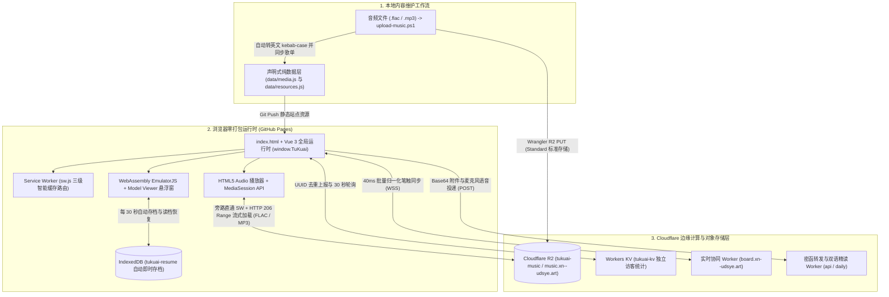

[English](README.md) | 简体中文

# TuKuai OS（少侠别走 · 土块.art）

<p align="center">
  
</p>

<p align="center">
  <b>沉浸式赛博朋克与复古像素风交互式 Web 虚拟操作系统</b> · <a href="https://xn--udsye.art">xn--udsye.art (土块.art)</a>
</p>

面向 **土块 (GallantTarry)** 个人主站的零打包器（Zero-Bundler）模块化 Web 虚拟操作系统，融合 Apple 毛玻璃视觉、CRT 像素交互、Cloudflare R2 云端无损音乐流式播放、WebAssembly 复古掌机模拟器、3D 场景展厅与全服实时协同涂鸦。日常所有内容维护（上传/升级无损音乐、新增外链网址、发布自研软件、添加游戏 ROM）均通过纯数据文件与一键上传脚本完成，无需改动 `index.html` 或运行任何前端打包工具。

---

## 日常内容维护速查指南

### 1. 上传新音乐或升级无损曲目（Cloudflare R2）

全站音频统一采用纯英文小写 `kebab-case` 命名（支持 `.flac` 真无损与 `.mp3`），托管在 Cloudflare R2 存储桶 `tukuai-music`（直链域名 `https://music.xn--udsye.art`），并在本地 `桌面/tukuai-music` 留存完整备份。

#### 方式 A：图形化选文件一键上传（最省心）
在项目根目录右键点击 [`upload-music.ps1`](./upload-music.ps1) 选择 **使用 PowerShell 运行**（或在终端无参执行 `.\upload-music.ps1`），在弹出的文件选择框中勾选一首或多首 `.flac` / `.mp3` 文件，脚本会自动完成：
1. 将文件名规范化为纯英文小写 `kebab-case`（例如 `Wind Poem.flac` -> `wind-poem.flac`），并归档备份至 `桌面/tukuai-music`。
2. 将音频以 `Standard` 标准存储类型上传至 R2（`tukuai-music`），自动写入对应 MIME 类型与 1 年 `Cache-Control` 缓存头。
3. 自动更新 [`assets/js/app/data/media.js`](./assets/js/app/data/media.js)：
   - **同曲升级无损（`.mp3` -> `.flac`）**：自动将该曲目在 `TK.data.playlist` 中的后缀原地替换为 `.flac`，并清理 R2 与本地桌面目录中被替代的旧 `.mp3`。
   - **新增曲目**：自动在 `TK.data.playlist` 末尾追加一行 `track('Song Title', 'song-title.flac')`。

#### 方式 B：命令行指定文件或全目录同步
```powershell
# 指定单曲上传并自定义播放器显示的英文曲名
.\upload-music.ps1 -Files "D:\Downloads\wind-poem.flac" -Title "Wind Poem"

# 将 桌面\tukuai-music 文件夹内的全部 .flac / .mp3 批量同步至 R2
.\upload-music.ps1 -SyncArchive
```

> [!TIP]
> 如需手动调整歌单播放顺序、修改显示的英文歌名或移除某首歌，直接编辑 [`assets/js/app/data/media.js`](./assets/js/app/data/media.js) 中的 `TK.data.playlist` 数组即可（每首歌仅一行 `track('显示歌名', '英文文件名.flac')`）。

---

### 2. 新增网址、自研软件、复古游戏与 3D 模型

全站 4 大资源板块的数据全部集中在 [`assets/js/app/data/resources.js`](./assets/js/app/data/resources.js)，无需修改 `index.html`：

1. **新增外部网站链接（「在线使用」板块）**：
   在 `TK.data.onlineTools` 数组中复制追加一行：
   ```javascript
   {name: 'GitHub', desc: '代码界的社交网络', url: 'https://github.com/'},
   ```
2. **新增自研独立软件（「文件下载 / 资源库」板块）**：
   按统一英文代号 `<slug>` 摆放图标 `assets/images/apps/<slug>.ico`、主页 `projects/<slug>/index.html`、片头动画 `projects/<slug>/video/intro.mp4` 与说明文档 `projects/<slug>/docs/manual.md`，然后在 `TK.data.projects` 中加一行：
   ```javascript
   project('my-app', 'MyApp', '一句话功能介绍'),
   ```
3. **新增掌机 ROM 或网页游戏（「复古游戏」板块）**：
   将 `.gba` / `.sfc` / `.smc` / `.nes` / `.gb` / `.gbc` / `.nds` ROM 放入 [`games/roms/`](./games/roms)，在 `TK.data.games` 中登记：
   ```javascript
   rom('🔫', '合金弹头 Advance', 'metal_slug.gba'),
   // 或添加在站内悬浮窗口打开的外部网页小游戏：
   {emoji: '🕹️', title: '网页游戏名称', desc: '一句话简介', url: 'https://example.com/game'},
   ```
4. **新增 3D 模型或创意互动网页（「创意空间」板块）**：
   将 `scene.gltf`、`scene.bin`、`textures/` 及复制自 `models/residential-block/index.html` 的入口页放入 `models/<slug>/`，在 `TK.data.creativeWorks` 中追加：
   ```javascript
   {emoji: '🌆', title: '赛博之城 3D 扫描', desc: 'By TuKuai', url: './models/cyber-city/index.html'},
   ```
5. **修改全局后端地址或跃迁外链**：
   打开 [`assets/js/app/config.js`](./assets/js/app/config.js) 修改 `TK.config.api`、`TK.config.links` 或 `TK.config.audioBaseUrl`。当同名覆盖替换大型缓存静态文件时，递增根目录 [`sw.js`](./sw.js) 顶部的 `CACHE_VERSION` 版本号即可强制老访客刷新缓存。

---

## 核心功能速览

- **PowerShell 拟物开机与动态作息人格**：矩阵乱码逐字解码启动指令（`irm xn--udsye.art|iex`），配备实时电子时钟、按 24 小时作息自动切换的 8 态像素小人头像与随机语录气泡。
- **R2 云端无损电子音乐终端**：精选 52 首原声与古典曲目由 Cloudflare R2（`music.xn--udsye.art`）提供 HTTP `206` 分片流式播放，配备随机切换 12 款像素 MV 的复古 CRT 小电视，并通过 `navigator.mediaSession` 完整接管 iOS 灵动岛、锁屏界面与键盘多媒体键。
- **全服实时协同「土块画板」**：基于 WebSocket 的多人实时共享涂鸦画板（`0~1` 归一化比例坐标、`2.5x` Retina 高分屏锐利适配与 40ms 笔触合并节流）。
- **双重全屏跃迁动效**：5-Phile 性格胶囊花瓣聚变旋转跃迁（DOM 实时坐标起飞 + 1080 度旋转绽放 + Web Audio API 实时合成五音和弦）与名言 CRT 过载坍缩跃迁。
- **WebAssembly 复古掌机厅与 3D 展厅**：内置 29 款 GBA/SFC 经典游戏并自研基于 `IndexedDB`（`tukuai-resume`）的 30 秒自动即时存档与关闭前抢救存档机制；内置带片头 `.mp4` 预加载的 5 款自研软件展厅与 4 座 `<model-viewer>` 3D 交互场景。
- **飞鸽传书密函与双语技术视界**：支持多附件及 `MediaRecorder` 原生麦克风录音试听的密函弹窗，以及右上角时钟唤醒的 `daily.html` GitHub Blog 中英双语对照精读终端。

---

## 全链路架构与数据流转图



---

## 分阶段流程与核心技术栈

| 阶段 | 数据流向（从哪到哪） | 采用的核心专业技术 | 具体完成的工作 |
| :--- | :--- | :--- | :--- |
| **1. 零打包模块化引导** | GitHub Pages -> `sw.js` -> `window.TuKuai` | Vue 3 全局构建版、Tailwind CSS v3.4、三级 `CacheStorage` 路由 | 按 `config.js` -> `utils` -> `data` -> `components` -> `composables` -> `main.js` 顺序零编译加载；HTML 走网络优先，游戏 ROM 与 3D 模型走绝对缓存优先，常规静态资源走后台静默热更新 |
| **2. 云端无损音频流** | `upload-music.ps1` -> Cloudflare R2 -> `<audio>` | Cloudflare R2 (`Standard`)、CORS `Range`、HTTP `206 Partial Content`、`MediaMetadata` | 将曲目规范为纯英文 `kebab-case` `.flac`/`.mp3` 托管于 `music.xn--udsye.art`；在 Service Worker 中直接旁路放行以保障任意拖拽秒响应，并将曲目状态实时同步至苹果灵动岛与系统锁屏 |
| **3. 实时协同与边缘接口** | 浏览器前端 <-> Cloudflare Workers | WebSocket (`wss://`)、Workers KV、HTML5 Canvas DPR `2.5x`、`MediaRecorder` | 将画板落笔转换为 `0.0000~1.0000` 比例坐标并按 40ms 队列合并广播（保留 5000 条历史回放），统计设备级独立访客 `fans`，并编码投递密函附件与语音留言 |
| **4. 沙箱悬浮窗与存档** | 主站宿主窗口 <-> `emulator.html` / `models/` | EmulatorJS WASM、`IndexedDB`、`<model-viewer>`、`postMessage` | 窗口最小化时采用 `opacity/visibility` 保活后台渲染进程；模拟器每 30 秒及关闭窗口前（`__tukuaiSaveNow`）自动快照存档至 IndexedDB，并支持 360 度 GLTF 3D 场景交互 |

---

## 目录结构

```text
tukuai-os/
├── index.html                          # 主站单页应用 HTML 骨架（Vue 3 运行时模板）
├── daily.html                          # 极客技术视界（GitHub Blog 中英双语精读终端）
├── sw.js                               # PWA Service Worker 三级智能缓存路由
├── upload-music.ps1                    # 一键上传音乐至 Cloudflare R2 并自动更新 media.js 脚本
├── hello.ps1                           # 终端音频同步独白彩蛋脚本（支持 irm xn--udsye.art/hello.ps1 | iex）
├── CNAME                               # 自定义域名绑定配置（xn--udsye.art）
├── README.md                           # 英文主文档（English-first 标准）
├── README.zh-CN.md                     # 同步简体中文文档
├── assets/
│   ├── css/                            # Tailwind CSS 源码/编译产物及毛玻璃、CRT 扫描线与跃迁手写样式
│   ├── fonts/                          # 本地 Silkscreen 与 Zpix 中文像素字体
│   ├── images/                         # 多尺寸图标、8 态作息像素头像、随机壁纸、12 款小电视 GIF 与软件图标
│   └── js/
│       ├── vendor/                     # 本地托管的 vue.global.js 与 model-viewer.min.js
│       └── app/
│           ├── config.js               # 全局 window.TuKuai 命名空间、后端接口地址与 R2 音乐根域名
│           ├── utils/helpers.js        # 通用无状态工具函数（时间格式化、随机抽取、音量渐弱）
│           ├── data/                   # 纯静态数据层（导航菜单、79 张资源卡片、R2 歌单、文案语录）
│           ├── components/             # 可复用 Vue 组件（板块容器、外链卡、启动卡、密函弹窗）
│           ├── composables/            # 13 个独立功能模块（音乐终端、协同画板、游戏窗口、双跃迁动效等）
│           ├── core/                   # 移动端禁缩放、Web Worker 后台标题跑马灯与 SW 热更新注册
│           └── main.js                 # 应用总装入口与浏览器 bfcache 后退状态恢复
├── games/                              # EmulatorJS WASM 内核、IndexedDB 自动存档承载页与 29 款 GBA/SFC ROM
├── models/                             # 4 座基于 <model-viewer> 的沉浸式 3D GLTF 场景展厅
└── projects/                           # 5 款自研软件与独立游戏官方展厅（含片头视频与在线说明书）
```

---

## 版权与使用声明

```text
Copyright (c) 2026 TuKuai (GallantTarry). All rights reserved.
```

本项目源码在 GitHub 公开仅用于**浏览、学习与技术交流**，**保留所有权利（非开源授权）**，详见 [`LICENSE`](./LICENSE)。仓库中包含的第三方前端库（`vue.global.js`、`model-viewer.min.js`）、像素字体（`assets/fonts/OFL.txt`）、模拟器内核（`GPL-3.0`）及 3D 扫描模型（`models/*/license.txt`，`CC-BY-4.0`）各自遵循其原始授权协议。
