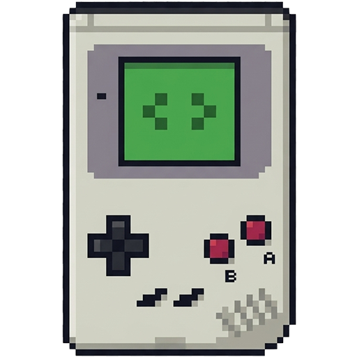
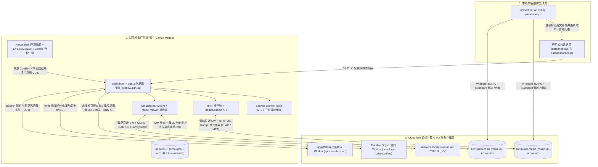

[English](README.md) | 简体中文

# TuKuai OS（少侠别走 · 土块.art）

<p align="center">
  
</p>

<p align="center">
  <b>沉浸式赛博朋克与复古像素风交互式 Web 虚拟操作系统</b> · <a href="https://xn--udsye.art">xn--udsye.art (土块.art)</a>
</p>

面向 **土块 (GallantTarry)** 个人主站的零打包器（Zero-Bundler）模块化 Web 虚拟操作系统，融合通透冰晶毛玻璃视觉、CRT 像素交互、Cloudflare R2 云端无损音乐流式播放、R2 云端驱动的 WebAssembly 复古掌机模拟器、3D 场景展厅与全服实时协同涂鸦。日常所有内容维护（上传/升级无损音乐、上传游戏 ROM、新增外链网址、更换 2K AVIF 壁纸、发布自研软件）均通过声明式数据文件与一键 PowerShell 脚本完成，无需改动 `index.html` 或运行任何 JS 打包器。

---

## 日常内容维护速查指南

### 1. 上传新音乐或升级无损曲目（`upload-music.ps1` -> Cloudflare R2）

全站音频统一采用纯英文小写 `kebab-case` 命名（支持 `.flac` 真无损与 `.mp3`），托管在 Cloudflare R2 存储桶 `tukuai-music`（直链域名 `https://music.xn--udsye.art`），并在本地 `桌面/tukuai-music` 留存完整备份。

- **图形化选文件一键上传（最省心）**：在项目根目录右键点击 [`upload-music.ps1`](./upload-music.ps1) 选择 **使用 PowerShell 运行**（或无参执行 `.\upload-music.ps1`），选择 `.flac` / `.mp3` 文件即可自动规范化英文命名、备份至桌面、以 `Standard` 类型上传 R2，并自动更新 [`assets/js/app/data/media.js`](./assets/js/app/data/media.js) 中的 `TK.data.playlist`（同名 `.mp3` 升级 `.flac` 时自动原地替换后缀并清理 R2 旧 `.mp3`）。
- **命令行指定文件或全目录同步**：
  ```powershell
  # 指定单曲上传（或升级已有曲目）并自定义显示的英文曲名
  .\upload-music.ps1 -Files "D:\Downloads\wind-poem.flac" -Title "Wind Poem"

  # 将 桌面\tukuai-music 内的全部 .flac / .mp3 批量同步至 R2
  .\upload-music.ps1 -SyncArchive
  ```

---

### 2. 新增网址、掌机游戏 ROM、背景壁纸、自研软件与 3D 模型

全站资源卡片与多媒体配置集中在 [`assets/js/app/data/resources.js`](./assets/js/app/data/resources.js) 与 [`assets/js/app/data/media.js`](./assets/js/app/data/media.js)：

1. **新增外部网站链接（「在线使用」板块）**：
   在 [`assets/js/app/data/resources.js`](./assets/js/app/data/resources.js) 的 `TK.data.onlineTools` 数组中追加一行：
   ```javascript
   {name: 'GitHub', desc: '代码界的社交网络', url: 'https://github.com/'},
   ```
2. **上传掌机 ROM 或新增网页游戏（「复古游戏」板块）**：
   掌机游戏 ROM（支持 `.gba` / `.sfc` / `.smc` / `.nds` / `.nes` / `.gb` / `.gbc`）统一托管在 Cloudflare R2 存储桶 `tukuai-roms`（直链域名 `https://roms.xn--udsye.art`，只读 CORS 全端口放行）：
   ```powershell
   # 右键 upload-rom.ps1 -> 使用 PowerShell 运行弹窗选文件，或使用命令行一键上传登记：
   .\upload-rom.ps1 -Files "D:\ROMs\metal_slug.gba" -Title "合金弹头 Advance" -Emoji "🔫"
   ```
   `upload-rom.ps1` 会自动把 ROM 上传至 R2 并在 `TK.data.games` 末尾追加 `rom('🔫', '合金弹头 Advance', 'metal_slug.gba')`。若添加外部网页小游戏，直接在 `TK.data.games` 中追加 `{emoji: '🕹️', title: '网页游戏名', desc: '一句话简介', url: 'https://example.com/'}` 即可。
3. **新增或替换全站随机背景壁纸（`2K AVIF`）**：
   将长边约 `2048px` 的轻量 `.avif` 壁纸放入 `assets/images/backgrounds/`，并在 [`assets/js/app/data/media.js`](./assets/js/app/data/media.js) 的 `TK.data.backgrounds` 数组中登记路径。
4. **新增自研独立软件（「文件下载 / 资源库」板块）**：
   按统一英文代号 `<slug>` 摆放图标 `assets/images/apps/<slug>.ico`、主页 `projects/<slug>/index.html`、片头动画 `projects/<slug>/video/intro.mp4` 与说明文档 `projects/<slug>/docs/manual.md`，然后在 `TK.data.projects` 中追加一行：
   ```javascript
   project('my-app', 'MyApp', '一句话功能介绍'),
   ```
5. **新增 3D 模型或创意互动网页（「创意空间」板块）**：
   将 `scene.gltf`、`scene.bin`、`textures/` 及复制自 `models/residential-block/index.html` 的入口页放入 `models/<slug>/`，在 `TK.data.creativeWorks` 中追加：
   ```javascript
   {emoji: '🌆', title: '赛博之城 3D 扫描', desc: 'By TuKuai', url: './models/cyber-city/index.html'},
   ```
6. **修改全局后端地址或缓存版本号**：
   打开 [`assets/js/app/config.js`](./assets/js/app/config.js) 修改 `TK.config.api`、`TK.config.links`、`TK.config.audioBaseUrl` 或 `TK.config.romBaseUrl`。同名覆盖替换静态文件后，递增 [`sw.js`](./sw.js) 顶部的 `CACHE_VERSION` 即可通知老访客自动刷新缓存。

---

## 核心功能速览

- **Cookie 授权联动的拟物开机与 `FANS` 计数**：自适应宽屏 PowerShell 矩阵解码开机动画（`irm xn--udsye.art|iex`）配合与「身份档案」等大覆盖的 `SYSTEM ALERT` 授权层。点击「同意！」写入本地 Cookie（`tukuai_cookie_consent`、`tukuai_device_uuid`）、触发设备去重的 `FANS +1` 并在下次访问时自动跳过开场动画；点击「拒绝~」不写任何本地数据、`FANS` 不增加，下次打开仍会播放开场动画并再次询问。
- **冰晶毛玻璃 Hi-Fi 电子音乐终端**：精选 52 首曲目由 Cloudflare R2（`music.xn--udsye.art`）提供 HTTP `206` 分片流式播放，配备黑曜石微缩 CRT 动态 MV 视窗、`FLAC` / `MP3` 音质徽章、4 柱实时像素频谱、霓虹渐变填充进度/音量条，并通过 `navigator.mediaSession` 完整接管 iOS 灵动岛、锁屏界面与键盘多媒体键。
- **全服实时协同「土块画板」**：基于 WebSocket 的多人实时共享涂鸦画板（`0~1` 归一化比例坐标、`2.5x` Retina 高分屏锐利适配与 40ms 笔触合并节流）。
- **双重全屏跃迁动效**：5-Phile 性格胶囊花瓣聚变旋转跃迁（DOM 实时坐标起飞 + 1080 度旋转绽放 + Web Audio API 实时合成五音和弦）与名言 CRT 过载坍缩跃迁。
- **R2 云端复古掌机厅与 3D 展厅**：29 款 GBA/SFC 经典游戏从 R2（`roms.xn--udsye.art`）直连拉取并由 EmulatorJS 原生 `IndexedDB`（`EmulatorJS-roms`）持久化缓存，内置每 30 秒自动即时存档（`tukuai-resume`）与底部果冻回弹读档提示；另含带片头 `.mp4` 预加载的 5 款自研软件展厅与 4 座 `<model-viewer>` 3D 交互场景。
- **飞鸽传书密函与双语技术视界**：支持多附件及 `MediaRecorder` 麦克风录音试听的密函弹窗，以及右上角时钟唤醒的 `daily.html` GitHub Blog 中英双语对照精读终端。

---

## 全链路架构与数据流转图



---

## 分阶段流程与核心技术栈

| 阶段 | 数据流向（从哪到哪） | 采用的核心专业技术 | 具体完成的工作 |
| :--- | :--- | :--- | :--- |
| **1. 零打包引导与授权门禁** | GitHub Pages -> `sw.js` -> `useCookieConsent` -> `window.TuKuai` | Vue 3 全局构建版、浏览器 `Cookie` (`SameSite=Lax`, 1 年有效)、`CacheStorage` | 按序零编译加载全部模块；将 2K `.avif` 壁纸、像素字体、模拟器 WASM 内核与 3D 模型纳入绝对缓存优先；严格依据用户 Cookie 授权决定是否跳过开场动画及上报 `FANS +1` |
| **2. 云端无损 Hi-Fi 音频流** | `upload-music.ps1` -> R2 `tukuai-music` -> `<audio>` | Cloudflare R2 (`Standard`)、CORS `Range`、HTTP `206 Partial Content`、`MediaMetadata` | 从 `music.xn--udsye.art` 直连流式读取纯英文 `kebab-case` `.flac`/`.mp3`（旁路 Service Worker 保障任意拖拽秒响应），并同步曲目状态至苹果灵动岛与系统媒体键 |
| **3. 云端掌机厅与自动存档** | `upload-rom.ps1` -> R2 `tukuai-roms` -> `emulator.html` -> `IndexedDB` | EmulatorJS v4.2.3 WASM、CORS `HEAD`/`GET`、`IndexedDB` (`EmulatorJS-roms` 与 `tukuai-resume`) | 首次运行从 `roms.xn--udsye.art` 直连下载并通过 `Content-Length` 校验缓存在 `EmulatorJS-roms`（上限 1 GB）；每 30 秒及关窗前自动保存快照，读档弹出底部果冻提示胶囊 |
| **4. 实时协同画板与边缘接口** | 浏览器前端 <-> Cloudflare Workers | WebSocket (`wss://`)、Durable Objects、Workers KV (`TUKUAI_KV`)、`MediaRecorder` | 将画板笔触转为 `0.0000~1.0000` 比例坐标按 40ms 批量广播（`2.5x` DPR 渲染、保留 5000 条历史），提供只读与 UUID 去重双模式粉丝计数，并投递密函附件与语音留言 |

---

## 目录结构

```text
tukuai-os/
├── index.html                          # 主站单页应用 HTML 骨架（Vue 3 运行时模板与通透冰晶毛玻璃界面）
├── daily.html                          # 极客技术视界（GitHub Blog 中英双语精读终端）
├── sw.js                               # PWA Service Worker 三级智能缓存路由（直连放行 R2 媒体双桶）
├── upload-music.ps1                    # 一键上传音乐至 Cloudflare R2 并自动更新 media.js 歌单脚本
├── upload-rom.ps1                      # 一键上传掌机 ROM 至 Cloudflare R2 并自动更新 resources.js 游戏脚本
├── hello.ps1                           # 终端音频同步独白彩蛋脚本（支持 irm xn--udsye.art/hello.ps1 | iex）
├── CNAME                               # 自定义域名绑定配置（xn--udsye.art）
├── README.md                           # 英文主文档（English-first 标准）
├── README.zh-CN.md                     # 同步简体中文文档
├── assets/
│   ├── css/                            # Tailwind 预编译 output.css 及冰晶毛玻璃、Hi-Fi 播控舱手写样式 style.css
│   ├── fonts/                          # 本地 Silkscreen 与 Zpix 中文像素字体
│   ├── images/                         # 多尺寸图标、8 态作息像素头像、6 张 2K AVIF 壁纸、12 款 CRT 动图与软件图标
│   └── js/
│       ├── vendor/                     # 本地托管的 vue.global.js 与 model-viewer.min.js
│       └── app/
│           ├── config.js               # 全局 window.TuKuai 命名空间、后端接口地址、R2 根域名与 Cookie 配置
│           ├── utils/helpers.js        # 通用无状态工具函数（时间格式化、颜色转换、音量渐弱、Cookie 与 UUID 工具）
│           ├── data/                   # 纯静态数据层（导航菜单、资源卡片、R2 歌单与 AVIF 壁纸、文案语录）
│           ├── components/             # 可复用 Vue 组件（统一板块容器、外链卡、启动卡、密函弹窗、三色引擎说明）
│           ├── composables/            # 13 个功能模块（Cookie 授权门禁、开机动画、访客统计、Hi-Fi 音乐、画板等）
│           ├── core/                   # 移动端禁缩放、Web Worker 后台标题跑马灯与 SW 热更新注册
│           └── main.js                 # 应用总装入口与浏览器 bfcache 后退状态恢复
├── games/                              # EmulatorJS WASM 内核与 R2 云端 ROM 自动存档承载页（emulator.html）
├── models/                             # 4 座基于 <model-viewer> 的沉浸式 3D GLTF 场景展厅
└── projects/                           # 5 款自研软件与独立游戏官方展厅（含片头视频与在线说明书）
```

---

## 版权与使用声明

```text
Copyright (c) 2026 TuKuai (GallantTarry). All rights reserved.
```

本项目源码在 GitHub 公开仅用于**浏览、学习与技术交流**，**保留所有权利（非开源授权）**，详见 [`LICENSE`](./LICENSE)。仓库中包含的第三方前端库（`vue.global.js`、`model-viewer.min.js`）、像素字体（`assets/fonts/OFL.txt`）、模拟器内核（EmulatorJS / RetroArch / mGBA / Snes9x，`GPL-3.0`）及 3D 扫描模型（`models/*/license.txt`，`CC-BY-4.0`）各自遵循其原始授权协议。
