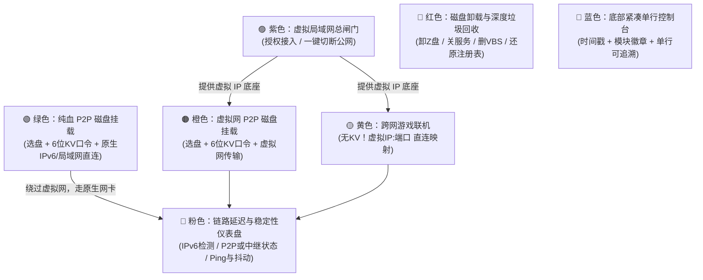

实在是太忙了，已经爆炸了，准备摸鱼养老了，今年就这样了，发一个体验版。

其他的先不管了，就点击绿色实现一个p2p同网段直链吧。
说明书今年也不写了，目前使用场景：
小王在家里有两台电脑，一台好电脑一台小电脑，好电脑2T磁盘有很多学习资料，小王想躺在床上学习，恰好两台电脑都在一个wifl下，且小电脑没有磁盘空间，那么小王就在好电脑上点击了绿色分享了磁盘，然后抱着自己的小电脑输入了密码挂载了磁盘，然后开开心心的坐在床上认真的学习了起来。与文件传输不同的地方仅仅在挂载，其实橙色也可以使用，只是虚拟网卡中继服务器远在天边，卡的不行，目前没有好方法，不搞了，休息！